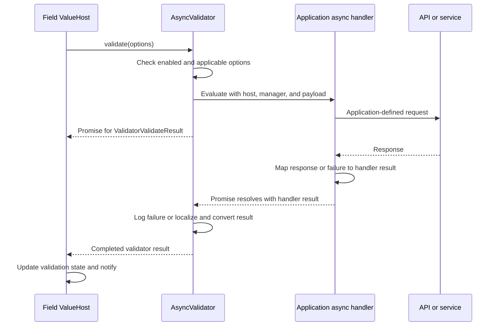

# Async Validator Design

## Purpose and status

Design a first-class async validator that can call application code or an API and report at most one `IssueFound`. This is a working design for discussion, not an implementation guide. Proposed API names and signatures below are illustrative until agreed.

The former async-validation discussion is retained as [obsolete historical material](./asyncCondition_design_OBSOLETE.md), not an active completion design. Manager completion remains separate work. [Submission planning](./Submission_planning.md) addresses the workflow that consumes the completed manager result.

### Established direction

- The work plan will make `ICondition.evaluate()` synchronous; asynchronous validation is performed by an `AsyncValidator`.
- An async validator reports at most one `IssueFound` using `ValidatorValidateResult.issueFound`.
- Its issue may specify a `valueHostName` different from its owning field; do not reject it for that reason. Supporting cross-field routing and validators on `ModelValidatorsValueHost` is future work.
- `AsyncValidatorConfig.handlerIdentity` is a required, stable, user-supplied identity string, exposed as `IValidator.errorCode` and unique among validators on the same ValueHost.
- A builder method accepts that identity, the application handler, its payload, and optionally dependent ValueHost names. The handler supplies the issue's error code and message.
- `IssueFound.errorCode` identifies and localizes the issue; it is not the async validator's identity. An external issue with the same issue code replaces the existing issue; different codes may both be displayed.
- The handler returns a Promise for its own result object. It must catch exceptions and always resolve that Promise successfully, reporting failures in the result. Its payload is supplied through the validator config and can hold application context such as an API wrapper.
- Preliminary and `duringEdit` validation skip async validators before invoking their handlers.
- The handler handles operational failures using `failedToResolve`, `Undetermined` and diagnostic information; the validator logs the failure at Error level, skips issue creation, and the host blocks saving.
- Async validators are ordered after synchronous validators. Async validation cannot stop already-started validators when its result is `Severe`; the severity may still be reported to the UI.
- Jivs handles message localization after receiving an issue result; the async validator supports only the `{Label}` message token.
- Jivs HTML-encodes the handler's `errorMessage` before using it as message text and before resolving tokens; the handler supplies unencoded text.
- Breaking API changes are acceptable, but existing repository consumers must be migrated.

## Current contracts

The current [`IValidator`](../packages/jivs-engine/src/Interfaces/Validator.ts) already allows asynchronous execution:

```ts
// Current code, excerpted from IValidator.
validate(options: ValidateOptions): ValidatorValidateResult | Promise<ValidatorValidateResult>;
```

Its result holds one issue:

```ts
// Current code, excerpted from Interfaces/Validator.ts.
export interface ValidatorValidateResult {
    conditionEvaluateResult: ConditionEvaluateResult;
    issueFound: IssueFound | null;
    skipped?: boolean;
}
```

Today the standard [`Validator`](../packages/jivs-engine/src/Validation/Validator.ts) runs a condition and constructs the issue for a `NoMatch`. Its `IValidator` interface requires a `condition`, `conditionType`, `errorCode`, dependency gathering, token support, enabled control, and validator swapping. Hosts use the condition category when ordering validators, performing preliminary validation, recognizing required validators, and generating data-type checks.

The existing [`ValidatorFactory`](../packages/jivs-engine/src/Validation/Validator.ts) selects a custom validator using `validatorType`, but its registered creator currently receives only the config, not the owning ValueHost. [`ValidatorBuilder.finish()`](../packages/jivs-builder/src/Builder/ValidatorBuilder.ts) currently requires a condition config or condition creator, and checks for duplicate resolved error codes. Both need attention for a condition-free validator.

The host already accepts a validator Promise, but its async path is not equivalent to its synchronous path:

```ts
// Current code, excerpted from ValidatorsValueHostBase.processPromise().
if (ivr.conditionEvaluateResult === ConditionEvaluateResult.NoMatch) {
    result.status = ValidationStatus.Invalid;
    if (!result.issuesFound)
        result.issuesFound = [];
    result.issuesFound.push(ivr.issueFound!);
    if (updateInstanceStateWithResult(result))
        self.invokeOnValueHostValidationStateChanged(options);
}
else
    deleteAsyncProcessFlag();
```

In particular, that branch does not normalize the issue's `doNotSave` according to severity as the synchronous branch does. The `Match` path shown clears the pending flag rather than setting a previously `Undetermined` result to `Valid`. These paths need to be accounted for in the host-completion project, not assumed correct merely because `IValidator` accepts a Promise.

## Responsibilities and flow

An application supplies an async handler. The validator owns its normal Jivs lifecycle and decides whether to invoke that handler; the handler performs the application-specific check and supplies an application-facing result. The validator converts it into the engine's `ValidatorValidateResult`. The ValueHost owns the overall validation state, pending work, and notifications. The manager's completion design determines when a full-form caller can use the final state.



A request failure is diagnostic information, not automatically a validation issue. It must block saving; manager completion must ensure the final state is available before submission.

## Candidate API

Peter proposes a result object specific to the handler, so application code does not have to set `skipped`, `doNotSave`, or a host's `Invalid` status. The handler returns that object in its Promise rather than receiving it as a parameter. The third parameter provides application context. The following illustrates the resulting three-parameter profile; names and payload typing are not finalized:

```ts
// Candidate signatures, not current code.
interface AsyncValidatorEvaluationResult {
    conditionEvaluateResult: ConditionEvaluateResult;
    errorCode?: string;
    errorMessage?: string;
    valueHostName?: ValueHostName;
    severity?: ValidationSeverity;
    failedToResolve?: boolean;
}

type AsyncValidatorEvaluateHandler = (
    valueHost: IValidatorsValueHost,
    valueHostsManager: IValueHostsManager,
    payload: unknown
) => Promise<AsyncValidatorEvaluationResult>;

interface AsyncValidatorConfig extends ValidatorConfig {
    handlerIdentity: string; // Required stable validator identity.
    errorCode?: never;
    errorMessage?: never;
    errorMessagel10n?: never;
    summaryMessage?: never;
    summaryMessagel10n?: never;
    handler: AsyncValidatorEvaluateHandler;
    payload?: unknown;
    dependencyValueHostNames?: string[];
}
```

`unknown` illustrates an untyped payload that application code must narrow; it is not a decision to impose a specific generic API.

For illustration, the handler maps both validation responses and request failures. `requireAvailabilityApi` is an application-provided payload guard, and `checkAvailability` is a method on that API wrapper. The wrapper is responsible for interpreting HTTP responses and rejecting operational failures; an HTTP error response does not inherently reject `fetch()`.

```ts
// Candidate application code; requireAvailabilityApi is application-owned.
const evaluateAvailability: AsyncValidatorEvaluateHandler =
    async (valueHost, valueHostsManager, payload) => {
        const value = valueHost.getValue();
        try {
            const api = requireAvailabilityApi(payload);
            const response = await api.checkAvailability(value);
            if (response.available) {
                return { conditionEvaluateResult: ConditionEvaluateResult.Match };
            }
            return {
                conditionEvaluateResult: ConditionEvaluateResult.NoMatch,
                errorCode: response.code,
                errorMessage: response.message,
                valueHostName: valueHost.getName()
            };
        }
        catch (failure) {
            return {
                conditionEvaluateResult: ConditionEvaluateResult.Undetermined,
                failedToResolve: true,
                errorCode: 'apierror',
                errorMessage: failure instanceof Error ? failure.message : String(failure)
            };
        }
    };
```

Here `apierror` is a diagnostic code for a failed operation, not a validation issue error code. The validator logs the diagnostic and produces a skipped result with a separate failure marker; the host blocks saving. The exception message is not displayed as a field error. Applications should avoid including secrets or sensitive response details in diagnostic messages.

The handler may use the manager where needed; it should capture the inputs it needs before awaiting so that its request and result refer to the same values. Capturing inputs is not a substitute for the host's stale-run protection.

### Result conversion to establish

| Handler result | Validator action |
| --- | --- |
| `Match`, no issue or failure data | Return `Match` with no `IssueFound`. |
| `NoMatch`, with validation error code and message | Build one `IssueFound`, including optional destination and severity, and return `NoMatch`. The error code is required; there is no condition type to supply a fallback. |
| `Undetermined`, no failure data | Return `Undetermined` with no issue when the handler legitimately could not evaluate. |
| `Undetermined`, `failedToResolve: true`, with diagnostic code and message | Log at Error level and return `Undetermined` with no issue, `skipped: true`, and a separate marker so the host blocks saving. |

This is a candidate shape, not finalized TypeScript. The handler is required to catch exceptions and always resolve its Promise successfully; it must communicate a failed operation through the result, not a rejection. Validate the returned object so a missing result or an inconsistent combination cannot silently become success. In particular, `NoMatch` needs a nonempty error code and nonempty message; an empty message is a `CodingError` (Q29). When `failedToResolve` is true the top-level code and message are diagnostic, not validation-issue data. Jivs, not the handler, determines `skipped`, blocking, and host status. Diagnostic failure codes are separate from validator identity and issue codes.

The existing host sets `Invalid` for an async `NoMatch` even when its issue is a warning; that host bug must be fixed so the new validator participates correctly. An unset `IssueFound.doNotSave` defaults to blocking, so the warning's non-blocking behavior must be explicit, not inferred from severity alone.

## Candidate integration design

### Validator interface and category

Prefer a genuine condition-free async validator rather than manufacturing a dummy condition solely to satisfy the current interface. One candidate is to expose the validator category directly on `IValidator`, make its `condition` optional or otherwise condition-specific, and update the host's category consumers to use the validator's category. The standard validator would continue deriving its category from its condition; the async validator would supply an appropriate category explicitly.

This is a candidate, not an agreed API. An async validator has no `conditionType`: it does not use a condition or look one up in `ConditionFactory`. The interface and consumers must accommodate that without inventing a misleading condition type. It still needs an error code, token behavior, swapping, dependencies, and enabled control. A separate condition-backed subinterface is another possible shape. Required and data-type-check detection and ordering must preserve existing behavior.

### Creation and builder

The factory should be able to construct the async validator with the same owning ValueHost supplied to the standard validator. A possible change is for registered validator creators to receive both the ValueHost and config. Review and migrate existing registered creators before deciding the exact signature.

The builder needs a path that adds an async validator without demanding a `conditionConfig` or `conditionCreator`. The call supplies the required validator identity, the handler, its payload, and optionally a list of dependencies:

```ts
// Candidate usage, not an existing builder method.
builder.field('UserName', LookupKey.String)
    .validatorAsync('AvailabilityCheck', evaluateAvailability, availabilityApi, ['AccountType']);
```

The first builder parameter is named `identity` and is stored as the config's required `handlerIdentity`. The payload is stored in the config; the factory passes it to the validator, which supplies it to the handler each time it runs. Unlike ordinary validator configuration, neither `AsyncValidatorConfig` nor `validatorAsync()` supplies the issue error code or message: the handler must supply them. Document this difference for end users. The configuration must define whether a payload can be omitted and who owns or disposes it; it must not inadvertently dispose a shared API or database service.

Neither the handler nor an arbitrary service reference can generally be represented in JSON, so this is application-code configuration. Document restoration and client/server registration and prevent accidental serialization or logging of sensitive payload contents. The impact on duplicate-identity checks is discussed next.

### Identity, messages, and swapping

**Decision:** Each async validator has a required, nonempty identity string in its config. It is stable for that configured validator, and `IValidator.errorCode` returns it. The application supplies the same identity when recreating the configuration; Jivs does not generate it from a counter or a function name.

The async config uses `handlerIdentity`, not `errorCode`, to distinguish validator identity from the issue code supplied by the handler. `IValidator.errorCode` still exposes that identity for compatibility. The inherited standard-validator config `errorCode` must not supply a competing value. The identity must be unique among all validators on its owning ValueHost, including condition-backed validators, so existing lookup and duplicate-error-code expectations can continue to work. A different ValueHost may use the same identity.

This identity is available before the handler runs and can be used for [`getValidator()`](../packages/jivs-engine/src/ValueHosts/ValidatorsValueHostBase.ts), enabled-state keys, and config matching. Stable identities preserve enabled overrides through host and manager reconstruction even when validator order changes. Renaming a validator changes its identity; the migration or cleanup behavior for state associated with the old identity needs to be defined.

The handler supplies the issue's error code and message. **Q26 decision:** `IssueFound.errorCode` is for issue processing and localization; it can differ from the validator identity and must not be used as the validator's identity. Current [`cleanupInstanceState()`](../packages/jivs-engine/src/ValueHosts/ValidatorsValueHostBase.ts) retains issues by matching their error codes against validator config codes. The implementation must account for the difference so a valid async issue is not discarded merely because its issue code differs from its validator identity. The [implementation guide](./AsyncValidator_Implementation.md) proposes companion ownership metadata in host instance state, not a new property on `IssueFound`.

#### External issue replacement

**Q27 direction:** The `IssueFound` passed to `addExternalIssueFound()` already contains what is needed to display the error. When its error code matches an existing issue, replace that issue. When the codes differ, the old and new issues can both remain visible. Matching is by **issue code**, not by the async validator's identity, and is scoped to the relevant ValueHost. An issue without a usable code cannot be assumed to match another issue.

This is not fully supported by the current path. [`ValidatorsValueHostBase.addExternalIssueFound()`](../packages/jivs-engine/src/ValueHosts/ValidatorsValueHostBase.ts) first asks validators to swap; the standard [`tryValidatorSwap()`](../packages/jivs-engine/src/Validation/Validator.ts) compares the incoming code with the validator's `errorCode` and creates a new issue using validator message configuration. Only when that swap succeeds does the host replace a matching entry in its validator-owned `issuesFound` list. Otherwise, the base implementation adds or replaces an entry in the separate `externalIssuesFound` list; it does not replace a matching validator-owned issue.

For example, if the async validator identity is `AvailabilityCheck`, its existing issue code is `NameTaken`, and an external `NameTaken` issue arrives, identity-based validator swapping alone will not find the validator. The two issue lists can currently both contribute `NameTaken` to the UI. Implement the agreed issue-code replacement across the relevant storage paths rather than relying solely on `IValidator.errorCode`. Preserve the externally supplied issue's display-ready content without requiring the async handler to have run; avoid re-encoding or re-resolving already formatted text.

**Ownership decision:** When an external issue replaces an existing async-validator-owned issue, the replacement remains validator-owned; subsequent validation can clear it. Preserve validator-swap blocking and severity semantics, including non-blocking warnings. An unmatched external issue remains external under the existing lifecycle.

**Q31 decision:** If multiple validator-owned issues have the same issue code, replace the first matching issue in stored `issuesFound` order and retain its validator owner; leave the other matches unchanged. The builder's duplicate-identity check does not rule out this case because handlers choose their issue codes at runtime.

#### Localization and tokens

Peter's direction is for the async validator to do the localization after the handler has returned the issue; the handler need not localize it. An async equivalent of [`updateIssueFoundWhenNoMatch()`](../packages/jivs-engine/src/Validation/Validator.ts) can use the completed issue's code and message, apply localization and resolve `{Label}`, and set severity, summary message, and blocking behavior.

The existing method resolves templates through `getErrorMessageTemplate()` and `getSummaryMessageTemplate()` and then applies the token resolver. Those helpers currently draw primarily from `ValidatorConfig`, not from a freshly returned async issue. The new implementation therefore needs to adapt the inputs rather than assume the existing method already uses the handler's message. Define localized-message precedence and fallback, including what happens if no localization is registered.

Support **only `{Label}`** in async-validator messages. The existing message token resolver resolves the tokens exposed by its supplied token sources; the async validator's token source should expose only `Label`, rather than the standard validator's additional `Value`, `DataType`, and condition tokens. Verify both error and summary messages. An external issue already carries display-ready content, even if the async handler has not run.

#### HTML encoding the handler's message

Peter's direction: the handler returns raw `AsyncValidatorEvaluationResult.errorMessage`; Jivs HTML-encodes that message before using it in `IssueFound.errorMessage` and before resolving tokens. The handler must not have to encode it. The existing engine already exposes [`encodeHtml()`](../packages/jivs-engine/src/Services/HtmlMessageTokenResolverService.ts), which escapes `&`, `<`, `>`, double quote, and single quote and does not encode the braces in `{Label}`.

The normal [`MessageTokenResolverService`](../packages/jivs-engine/src/Services/MessageTokenResolverService.ts) replaces tokens but does **not** encode the surrounding message. Its [`HtmlMessageTokenResolverService`](../packages/jivs-engine/src/Services/HtmlMessageTokenResolverService.ts) subclass encodes each replacement and wraps it in a span. Encoding the handler's message first therefore covers a different part of the output from encoding the token replacement.

Candidate processing order, subject to the localization fallback design:

1. Encode the raw handler message exactly once using the existing HTML encoder.
2. Select the localized error template, using that encoded handler message as a possible fallback. A localized template is a separate source and needs an explicit trust/HTML policy; do not assume that encoding the fallback also encoded a selected translation.
3. Resolve `{Label}` on the selected template, using the HTML token resolver where HTML output is required. Do not encode the entire final string again: doing so would double-encode entities and escape the resolver's span markup.
4. Apply the same source-aware rule to the summary message. If the summary falls back to the already processed error message, reuse it rather than encoding or resolving it again.

For example, the raw handler template `Invalid <value> for {Label} & account` becomes `Invalid &lt;value&gt; for {Label} &amp; account` before token resolution. The HTML resolver separately encodes the label value it inserts. Test raw angle brackets, ampersands and quotes, a label containing HTML-sensitive characters, localization fallback, and the summary fallback.

**Output-context concern:** the plain token resolver does not HTML-encode label replacements. Also, HTML-encoded message text displayed as literal text rather than rendered as HTML will show entities. Peter's requested encoding is recorded above; the implementation and documentation must explicitly address HTML versus plain-text/server consumers and avoid claiming that the plain resolver makes the whole result safe for HTML.

PETER's NOTE: I am aware that we'd be hardcoding htmlencoding into the jivs-engine side, where non-HTML consumers may use it.

### Execution policy

The validator checks enabled state and execution options before starting its handler. **When `preliminary` or `duringEdit` is true, it is skipped without invoking the handler.** A later normal validation must still run it. Enabler behavior remains open.

### Cross-field dependencies

The handler may read other ValueHosts from the manager. Peter proposes declaring their names as an optional builder parameter, similar to `CalcValueHostConfig.dependencyValueHostNames`.

The engine already has a validation-specific mechanism that can be reused:

1. [`IValidator.gatherValueHostNames()`](../packages/jivs-engine/src/Interfaces/Validator.ts) contributes names. `ValidatorsValueHostBase.gatherValueHostNames()` gathers names from every validator on the field.
2. [`otherValueHostChangedNotification()`](../packages/jivs-engine/src/ValueHosts/ValidatableValueHostBase.ts) caches those names and checks changed names against the set. If validation was previously attempted, a relevant change triggers validation when `revalidate` is true; otherwise it marks the host `NeedsValidation`. A host still at `NotAttempted` is left alone.
3. The async validator can add its declared names to the set; no separate calculation dependency mechanism is needed. The cache assumes immutable configuration and is cleared by recreating the ValueHost, so configuration changes must honor that lifecycle.

This behavior revalidates the **whole host**, not just the dependent validator, and can launch another background request. Define how inputs are captured and how obsolete results are suppressed when a dependency changes or another run supersedes it; declaring names alone does not solve stale results. The owner field's own changes already follow its normal validation path and need not be listed as another field dependency.

### Ordering and severity

The current host sorts on `validator.condition.category` so `Require` comes first and data-type checks follow; a synchronous `Severe` issue stops the remaining loop. The async path starts the Promise and immediately continues the loop, so an async `Severe` result cannot stop validators that have already started. It may still put `Severe` on the issue for the UI, with blocking semantics, but it must not be interpreted as a synchronous stop.

Async validators will be ordered after synchronous validators. This lets an earlier synchronous `Severe` failure prevent unnecessary requests while preserving required/data-type priority. It does not serialize async validators or allow one async severe result to stop another. Preserve a stable order within each group.

### Failure and completion

The application handler catches operational failures, reports `failedToResolve: true`, `Undetermined` and diagnostic code/message, and resolves its Promise normally. The `AsyncValidator` logs that diagnostic at `LoggingLevel.Error` and converts it to a skipped result with no issue and a failure marker. The host records the failed validator and blocks saving. Logging should happen once at the validator boundary; malformed handler output or an unexpected thrown error is a programming error and must not disappear silently or allow saving.

The validator returns its Promise to the host immediately. The host tracks it in the existing pending mechanism; manager validation waits as designed separately. **Q20 decision:** an API failure blocks saving. `skipped`/`Undetermined` plus logging does not itself block saving in the current engine, so host state and `doNotSave` need the separate failure marker described in the implementation guide. Manager completion remains separate work.

### Work plan: condition contract cleanup

The planned work includes changing `ICondition.evaluate()` from `ConditionEvaluateResult | Promise<ConditionEvaluateResult>` to `ConditionEvaluateResult`, and removing the standard validator's corresponding Promise dispatch. Inventory and migrate all affected implementations, direct callers, composite/enabler logic, public interfaces, examples, documentation, and tests. Existing Promise-returning custom implementations must migrate to the new async validator. The `IValidator.validate()` Promise path remains for `AsyncValidator`.

## Verification scenarios

- A callback reports `Match`, `NoMatch`, and a warning; the host and form expose the intended state.
- The result contains one mapped issue, including a different `valueHostName`, without rejecting it. Do not claim cross-field presentation unless separately implemented.
- Disabled, preliminary, and `duringEdit` validation do not invoke the handler; normal validation does.
- A handled API failure logs its code and message at Error level, yields the agreed skipped result and keeps `doNotSave` true after pending work finishes; a later successful retry clears the corresponding failure. A broken handler contract is observable and does not permit saving.
- Two async validators, and an edit during a pending validation, preserve correct state and do not apply stale results.
- Factory creation and fluent builder setup supply the required identity, owning ValueHost, callback, payload and dependencies; reject missing or duplicate identities.
- Enabled overrides remain attached to the same named validator after reconstruction and reordering; lookup works before its handler runs.
- An issue code distinct from the validator identity is preserved, drives localization, and remains associated with its validator through applicable state cleanup.
- A matching external issue replaces an existing validator-owned or external issue by issue code, including when that code differs from the async validator identity. Different codes can remain visible; an external issue can be displayed before the async handler has run.
- Verify replacement preserves the agreed display content, severity and blocking/clearing behavior without double encoding.
- Localize the returned issue in Jivs and resolve `{Label}` in error and summary messages without exposing other validator tokens.
- Encode raw handler messages before token resolution; verify HTML-sensitive message text and label replacements, localization, summary fallback, and no double encoding.
- Synchronous validators run before async validators; synchronous severe failures prevent subsequent async requests.
- Condition-based validators retain sorting, required/data-type recognition, messages, swap behavior, and synchronous evaluation after the `ICondition.evaluate()` contract changes.
- Test dependencies, callbacks and logging according to [Testing Approach](../docs/assets/Testing_Approach.md); add client/server documentation and a usable example.

## Decisions and open design questions

### Q20 — Failure and submission (decided)

An API failure blocks saving. It remains diagnostic, not a displayed field validation issue.

### Q28–Q30

The answers and implementation implications are recorded in the [implementation guide](./AsyncValidator_Implementation.md#remaining-decisions-and-release-gate).

