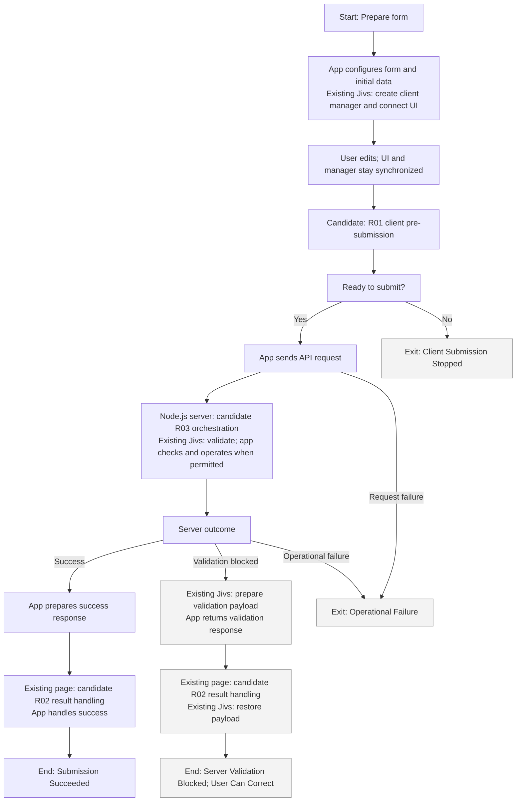
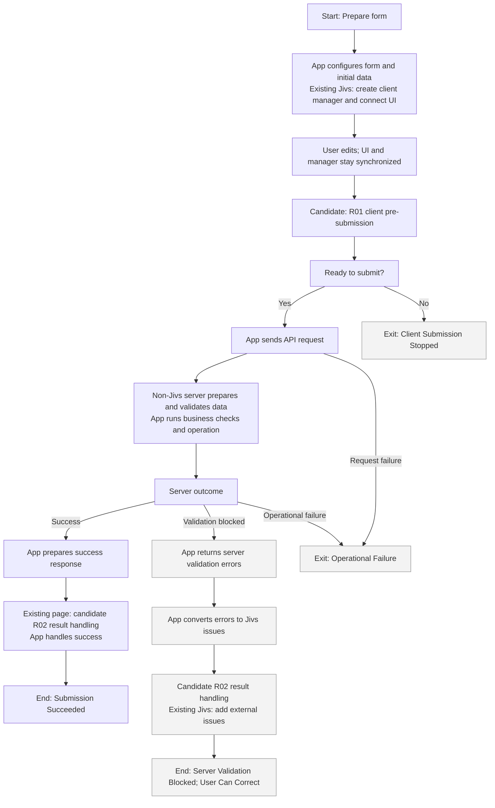
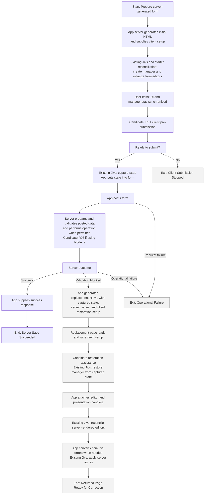

# Client-Side Submission Design

## Purpose and scope

[Purpose, scope, and relationship to the planning document to be written.]

## User-facing examples

[Examples to be designed first; use them to establish the desired developer experience.]

## Lifecycle and Jivs assistance

The submission workflow is part of a larger form lifecycle. This design shows where Jivs-provided code fits into that lifecycle, including the surrounding application work. It distinguishes existing facilities from assistance proposed by this design; candidate helpers, packages, and APIs remain subject to the design below.

The lifecycle has six parts:

1. **Prepare the form.** Create the client `ValueHostsManager` and initialize it with the form's initial data.
2. **Handle user interactions.** Keep the manager and the visible form synchronized as the user edits.
3. **Start client submission.** Validate and prepare data before handing it to the server.
4. **Process the request on the server.** Prepare and independently validate the request, run business checks, and perform the operation when permitted.
5. **Prepare the server-to-client handoff.** Communicate the outcome, especially validation issues. Consider operational failures separately and how they may be presented through Jivs.
6. **Follow the result on the client.** The existing page handles an API result, or a returned page loads and executes its setup to restore state and present issues.

For server-generated pages, the server supplies the initial HTML and the application delivers client setup code. A new page initializes from its editors; a page returned after server validation failure restores the submitted captured state, connects the UI, reconciles the regenerated editors, and applies the server issues. Unchanged editor values retain their restored state; server-changed values are read and reset for preliminary validation. Setup code can be bundled, included in a script file, or injected; it need not be generated anew on each request. See the [server-pages guide](../docs/Learning_Jivs/Server_Pages/Home.md) for the Page Load and Page Save workflows; its Page Save description needs updating to reflect this reconciliation decision.

The Learning Jivs documentation has not yet been updated to reflect jivs-dom. It is expected to adopt jivs-dom approaches, with generic approaches moved to API documentation where appropriate. Use the existing server-pages guides for their lifecycle distinctions, but evaluate startup assistance against the actual jivs-dom facilities rather than assuming the guides' generic setup is the intended final API.

### Three first-class approaches

All three approaches need an end-to-end view across these six parts, while sharing focused workflows where appropriate:

- **A01 — Client API with Jivs on a Node.js server.** The existing page handles the response, including a Jivs Validation Payload.
- **A02 — Client API with a non-Jivs server.** The existing page handles the response and converts the server's validation errors for Jivs.
- **A03 — Server-generated page submission.** The client posts the form; on validation failure the server returns HTML and client setup for a replacement page. The server may use Jivs or another validation system.

A01 and A02 expand the existing V01 client API variation; V04 describes Node.js API processing when applicable. A03 covers V02 and its V03 continuation; V05 describes the Node.js form-data server variation when applicable. Request format, server technology, validation system, and page lifecycle remain independent choices.

### Assistance at each lifecycle stage

| Stage | Existing Jivs facilities and prior art | Assistance designed here | Application-owned work |
| --- | --- | --- | --- |
| Form preparation | Manager configuration and initialization; DOM presentation facilities; editor reconciliation in the [starter helpers](../starter_code/jivs-DOM_helpers.ts). | Shared setup or restoration assistance where existing facilities leave a gap. | Rules, initial data, page markup, and delivery of client setup. |
| User interactions | ValueHost and DOM integration facilities; starter editor-event helpers and SimpleDom presentation. | Reuse existing integration; identify any submission-specific gaps. | Application-specific editors, interaction, and presentation choices. |
| Client submission | Async manager validation, `ModelWriter`, and the starter API submission classes. | Reusable pre-submission orchestration for API calls and native form posts, including issue handling; jivs-dom native-post event wiring (Q36). | Business rules, preparation, and communication; applications may use their own submission triggering and wiring. API submission does not require an HTML form (Q01). |
| Server processing | Jivs validation and payload APIs are available on Node.js; the [server-side guidance](../docs/Learning_Jivs/Understanding_Server_Side_Validation.md) also covers non-Jivs servers. | Node.js helpers for request preparation, validation, and response preparation. | Server framework, authoritative validation where not supplied by Jivs, business rules, and the operation. Non-Node.js servers do not use a Node.js package. |
| Server-to-client handoff | Jivs validation payload and captured-state APIs; the server-pages guide describes transporting state and issues. | Assistance with payloads and transport conventions for API responses or returned pages. | Response contract, server-generated HTML and transport encoding, and operational-failure policy. |
| Client follows result | `fromValidationPayload()`, external-issue APIs, and captured-state restoration; starter API result handlers. | Reusable API-result handling and returned-page restoration assistance. | Error conversion for other systems, setup delivery, success behavior, and application-specific failure handling. |

These are responsibilities to design, not a decision to replace an application's page generation or to require a helper. Existing starter code is prior art, not necessarily a shipped package API. The server-pages guide remains the source for Round Trip and Elements Changed workflows unless submission design identifies a shared need.

### Diagram conventions

The primary path runs top-to-bottom. Departures from a focused path branch toward named endpoints; another diagram may continue from that endpoint. Mermaid chooses the final layout, so exact connector placement is not guaranteed. A numbers identify end-to-end approaches, V numbers identify variations, R numbers identify reusable workflows, and endpoint names describe handoffs or outcomes rather than new implementation APIs. The diagrams are design aids; their branches do not settle the open design questions.

### End-to-end approach diagrams

Each overview includes initial setup and interaction, server processing, and the client handoff. The main success path is vertical; validation failures are shown through the point where the client can present them. Other failures leave through a consolidated endpoint. The existing facilities and designed assistance identified above are shown at their place in the workflow; application actions remain application-owned.

#### A01 — Client API with Jivs on a Node.js server

Server validation is independent of client validation. Jivs server validation issues can be returned as a payload; business issues can be included using the server's Jivs payload facilities. Handling ambiguous responses and operational failures remains open (T04).

#### A02 — Client API with a non-Jivs server

The server controls its validation and response format. The application's conversion supplies the Jivs issue shapes; candidate R02 result handling can orchestrate their import.

#### A03 — Server-generated page submission

This is one overall lifecycle, including V02 and the V03 validation-failure continuation. The server and client portions of page preparation are distinct; the focused V03 diagram expands the returned-page setup.

The request's form data is used for server validation and the operation; captured Jivs state is returned unchanged for client restoration. Jivs-payload restoration and non-Jivs error conversion remain distinct. Success and operational failure responses follow the application contract, not necessarily V03. Transport encoding and presentation safety remain open (T05).

## Workflow overview

The submitter orchestrates the sequence and decides when processing must stop. Application-specific behavior remains supplied by subclasses or other application code: model creation, business validation, communication, failure presentation, server-error mapping, and success behavior.

The following sequence describes the current API-oriented workflow. The variations and responsibilities are expanded in the surrounding sections.

1. **Start submission.** The application invokes the submission operation. The starter helper does not attach a DOM submit event; some surrounding application code must call it. The jivs-dom native-post binding can provide event wiring separately (Q36).

    The planned `submit()` operation is asynchronous and encapsulates the workflow. It resolves with an explicit outcome for validation blocking or an overlapping attempt, and rejects for unexpected failures or exhausted retries (Q51, Q54, Q55). It calls and awaits manager validation without a separate check for already-running validation (Q18).
2. **Validate the form with Jivs.** Call `ValueHostsManager.validate()` to validate the current form state and update validation presentation through the manager's callbacks. If `ValidationState.doNotSave` is true, stop without building or sending a model.

    The client-side `validate()` call causes the UI to refresh all validation-state-changed elements, whether field or form. jivs-dom handles this by intercepting the `ValueHostsManager.onValidationState` and `onValueHostValidationState` callbacks.
3. **Build the model.** Create a model and use `ModelWriter` to copy configured FieldValueHost values into it. Field configuration determines the Model property mapping.

    The workflow does not require a Model for every submission. A native post skips Model creation when client business validation is not configured; an API request can create one when needed (Q32).
4. **Run optional client business validation.** Check the completed Model for issues not covered by Jivs field validation. The starter helper adds any returned issues to the manager as locally determined issues and stops, even for warnings.

    The designed workflow converts application errors through `IExternalIssueConverter` (Q11), adds the resulting issues to the manager, and continues when the whole manager's `doNotSave` is false, including when there are non-blocking warnings (Q10 and Q62).

    The Model supports separation of business logic from Jivs and simplifies testing without a `ValueHostsManager`. Application-specific logic may still access the manager where needed.
5. **Send the model.** Delegate serialization and communication to the application's request implementation.

    This is where server-page submission breaks from the API workflow. The form is posted and a returned page runs client setup supplied by the application, which may be bundled, included in a script file, or embedded.
6. **Handle request and HTTP failures.** If the request implementation throws, invoke the application's connection-failure handler and stop. If it returns a response that the HTTP-failure handler classifies as an operational failure, handle it, log it, and stop. These failures are distinct from validation errors and may not be added to the validation manager. However, the Validation Summary may be a suitable place to notify the user. The application may add an external issue with a localizable replacement message while logging the technical error.
7. **Handle server validation.** If the response contains validation issues, put them into the client's Jivs state and stop:
   - With a Jivs server, restore the returned validation payload through `ValueHostsManager.fromValidationPayload()`.
   - With another validation system, convert its errors to `IssueFound` objects and add them as externally determined issues through `ValueHostsManager.addExternalIssuesFound()`.
8. **Complete successfully.** If neither failure handler stops the flow, invoke the application's success behavior. The starter helper uses the Model returned by the server when present; otherwise, it uses the submitted Model.

## Object model and responsibilities

[Design the objects, ownership, and boundaries across jivs-engine, jivs-dom, and application code.]

## Public usage and extension points

[Design the public usage, API shape, and extension points.]

## Submission lifecycle and outcomes

[Design lifecycle behavior, outcomes, freshness retries, concurrency, and failure handling.]

## Native-post integration

[Design the jivs-dom native-post binding and browser handoff.]

## Server-page startup and restoration

[Design startup, captured-state restoration, editor reconciliation, and issue application.]

## Configuration, localization, and diagnostics

[Design configuration, localized messages, logging, and user-facing failure presentation.]

## Open design questions

[Record questions with sequential identifiers such as Q01, Q02, and their decisions.]

## Follow-up work

[Record implementation, documentation, and validation follow-ups.]