# Client-Side Submission Workflow

## Purpose and status

This document records the initial understanding of the client-side submission workflow, based on the existing [submission guide](../docs/Learning_Jivs/Submitting_the_Client_Form.md) and [starter helper classes](../starter_code/jivs-DOM_helpers.ts).

The goal is to describe the purpose of each action and its stop conditions clearly enough to compare a future implementation against the intended workflow. This is an initial planning document, not a coding guide; the questions at the end record both decisions and items still open for Peter's review.

## Developer's decision to use this
Existing apps already have a workflow for page submission. We are providing another one, wrapped in our own class. Ours exists because submission workflow always contains validation -> submit -> report errors back into the validation UI, which places Jivs front and center.

We don't want the user to think our class is required, but want to entice them to use it, especially if creating a new app. Our developer docs must still preserve education on developing with Jivs inside of the existing workflow.

## Lifecycle and Jivs assistance

The submission workflow is part of a larger form lifecycle. The developer's documentation should show where Jivs-provided code fits into that lifecycle, including the surrounding application work. Planning must distinguish existing facilities from assistance we might build; neither the candidate helpers nor their packages or APIs are decided.

The lifecycle has six parts:

1. **Prepare the form.** Create the client `ValueHostsManager` and initialize it with the form's initial data.
2. **Handle user interactions.** Keep the manager and the visible form synchronized as the user edits.
3. **Start client submission.** Validate and prepare data before handing it to the server.
4. **Process the request on the server.** Prepare and independently validate the request, run business checks, and perform the operation when permitted.
5. **Prepare the server-to-client handoff.** Communicate the outcome, especially validation issues. Consider operational failures separately and how they may be presented through Jivs.
6. **Follow the result on the client.** The existing page handles an API result, or a returned page loads and executes its setup to restore state and present issues.

For server-generated pages, the server supplies the initial HTML and the application delivers client setup code. A new page initializes from its editors; a page returned after server validation failure restores the submitted captured state, connects the UI, reconciles the regenerated editors, and applies the server issues. Unchanged editor values retain their restored state; server-changed values are read and reset for preliminary validation. Setup code can be bundled, included in a script file, or injected; it need not be generated anew on each request. See the [server-pages guide](../docs/Learning_Jivs/Server_Pages/Home.md) for the Page Load and Page Save workflows; its Page Save description needs updating to reflect this reconciliation decision.

The Learning Jivs documentation has not yet been updated to reflect jivs-dom. It is expected to adopt jivs-dom approaches, with generic approaches moved to API documentation where appropriate. Use the existing server-pages guides for their lifecycle distinctions, but evaluate startup assistance against the actual jivs-dom facilities rather than assuming the guides' generic setup is the intended final API.

### Three first-class approaches

All three approaches need an end-to-end view across these six parts, while sharing focused workflows where appropriate:

- **A01 — Client API with Jivs on a Node.js server.** The existing page handles the response, including a Jivs Validation Payload.
- **A02 — Client API with a non-Jivs server.** The existing page handles the response and converts the server's validation errors for Jivs.
- **A03 — Server-generated page submission.** The client posts the form; on validation failure the server returns HTML and client setup for a replacement page. The server may use Jivs or another validation system.

A01 and A02 expand the existing V01 client API variation; V04 describes Node.js API processing when applicable. A03 covers V02 and its V03 continuation; V05 describes the Node.js form-data server variation when applicable. Request format, server technology, validation system, and page lifecycle remain independent choices.

### Assistance at each lifecycle stage

| Stage | Existing Jivs facilities and prior art | Candidate assistance to evaluate | Application-owned work |
| --- | --- | --- | --- |
| Form preparation | Manager configuration and initialization; DOM presentation facilities; editor reconciliation in the [starter helpers](../starter_code/jivs-DOM_helpers.ts). | Shared setup or restoration assistance where existing facilities leave a gap. | Rules, initial data, page markup, and delivery of client setup. |
| User interactions | ValueHost and DOM integration facilities; starter editor-event helpers and SimpleDom presentation. | Reuse existing integration; identify any submission-specific gaps. | Application-specific editors, interaction, and presentation choices. |
| Client submission | Async manager validation, `ModelWriter`, and the starter API submission classes. | Reusable pre-submission orchestration for API calls and native form posts, including issue handling; jivs-dom native-post event wiring (Q36). | Business rules, preparation, and communication; applications may use their own submission triggering and wiring. API submission does not require an HTML form (Q01). |
| Server processing | Jivs validation and payload APIs are available on Node.js; the [server-side guidance](../docs/Learning_Jivs/Understanding_Server_Side_Validation.md) also covers non-Jivs servers. | Node.js helpers for request preparation, validation, and response preparation. | Server framework, authoritative validation where not supplied by Jivs, business rules, and the operation. Non-Node.js servers do not use a Node.js package. |
| Server-to-client handoff | Jivs validation payload and captured-state APIs; the server-pages guide describes transporting state and issues. | Assistance with payloads and transport conventions for API responses or returned pages. | Response contract, server-generated HTML and transport encoding, and operational-failure policy. |
| Client follows result | `fromValidationPayload()`, external-issue APIs, and captured-state restoration; starter API result handlers. | Reusable API-result handling and returned-page restoration assistance. | Error conversion for other systems, setup delivery, success behavior, and application-specific failure handling. |

These are responsibilities to investigate, not a decision to replace an application's page generation or to require a helper. Existing starter code is prior art, not necessarily a shipped package API. The server-pages guide remains the source for Round Trip and Elements Changed workflows unless submission planning identifies a shared need.

### Diagram conventions

The primary path runs top-to-bottom. Departures from a focused path branch toward named endpoints; another diagram may continue from that endpoint. Mermaid chooses the final layout, so exact connector placement is not guaranteed. A numbers identify end-to-end approaches, V numbers identify variations, R numbers identify reusable workflows, and endpoint names describe handoffs or outcomes rather than new implementation APIs. The diagrams are planning aids: their branches do not settle the open design questions.

### End-to-end approach diagrams

Each overview includes initial setup and interaction, server processing, and the client handoff. The main success path is vertical; validation failures are shown through the point where the client can present them. Other failures leave through a consolidated endpoint. The existing facilities and candidate assistance identified above are shown at their place in the workflow; application actions remain application-owned.

#### A01 — Client API with Jivs on a Node.js server

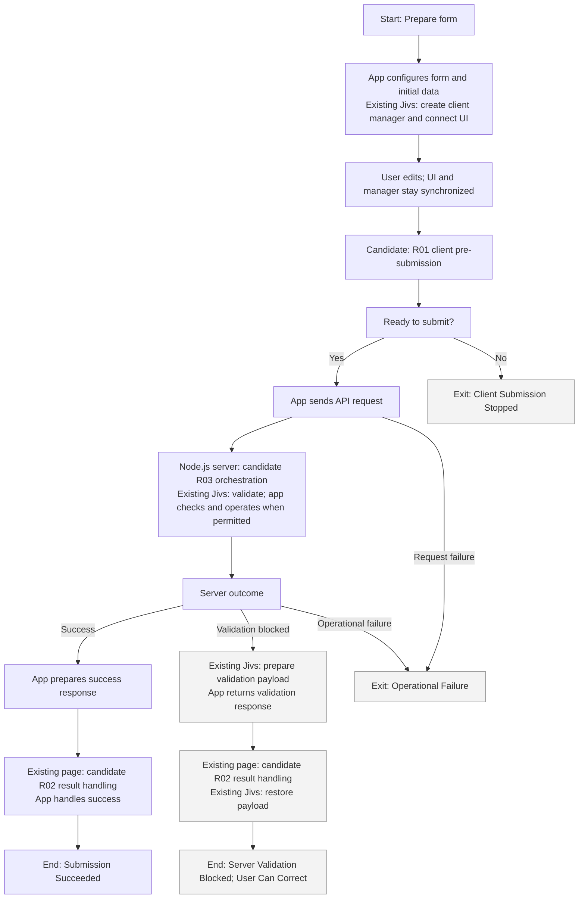

Server validation is independent of client validation. Jivs server validation issues can be returned as a payload; business issues can be included using the server's Jivs payload facilities. Handling ambiguous responses and operational failures remains open (T04).

#### A02 — Client API with a non-Jivs server

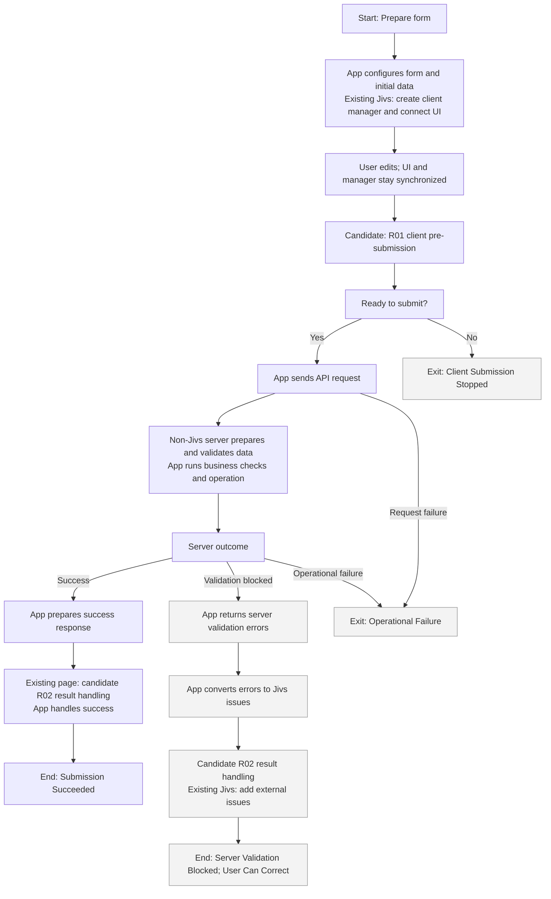

The server controls its validation and response format. The application's conversion supplies the Jivs issue shapes; candidate R02 result handling can orchestrate their import.

#### A03 — Server-generated page submission

This is one overall lifecycle, including V02 and the V03 validation-failure continuation. The server and client portions of page preparation are distinct; the focused V03 diagram expands the returned-page setup.

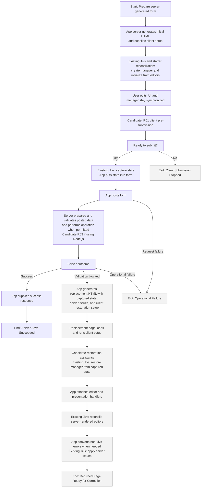

The request's form data is used for server validation and the operation; captured Jivs state is returned unchanged for client restoration. Jivs-payload restoration and non-Jivs error conversion remain distinct. Success and operational failure responses follow the application contract, not necessarily V03. Transport encoding and presentation safety remain open (T05).

## Workflow overview

The submission class orchestrates the sequence and decides when processing must stop. Application-specific behavior remains supplied by subclasses or other application code: model creation, business validation, communication, failure presentation, server-error mapping, and success behavior.

The following sequence describes the starter helper's API-oriented path. The planning notes and questions below identify variations that it does not yet cover.

1. **Start submission.** The application invokes the submission operation. The starter helper does not attach a DOM submit event; some surrounding application code must call it. The planned jivs-dom native-post binding can provide event wiring separately (Q36).

    The planned `submit()` operation is asynchronous and encapsulates the workflow. It resolves with an explicit outcome for validation blocking or an overlapping attempt, and rejects for unexpected failures or exhausted retries (Q51, Q54, Q55). It calls and awaits manager validation without a separate check for already-running validation (Q18).
2. **Validate the form with Jivs.** Call `ValueHostsManager.validate()` to validate the current form state and update validation presentation through the manager's callbacks. If `ValidationState.doNotSave` is true, stop without building or sending a model.

    By design, the client-side validate() call will cause the UI to refresh all validation state changed elements, whether field or form. That is handled by jivs-dom intercepting the `ValueHostsManager.onValidationState` and `onValueHostValidationState` callbacks.
3. **Build the model.** Create a model and use `ModelWriter` to copy configured FieldValueHost values into it. Field configuration determines the Model property mapping.

    The planned workflow does not require a Model for every submission. A native post skips Model creation when client business validation is not configured; an API request can create one when needed (Q32).
4. **Run optional client business validation.** Check the completed Model for issues not covered by Jivs field validation. The starter helper adds any returned issues to the manager as locally determined issues and stops, even for warnings.

    The planned workflow converts application errors through `IExternalIssueConverter` (Q11), adds the resulting issues to the manager, and continues when the whole manager's `doNotSave` is false, including when there are non-blocking warnings (Q10 and Q62).

    The Model supports separation of business logic from Jivs and simplifies testing without a `ValueHostsManager`. Application-specific logic may still access the manager where needed.
5. **Send the model.** Delegate serialization and communication to the application's `saveModel()` implementation.

    This is the point where server-page submission breaks from the API workflow. The form is posted and a returned page runs client setup supplied by the application, which may be bundled, included in a script file, or embedded.
6. **Handle request and HTTP failures.** If `saveModel()` throws, call the application's connection-failure handler and stop. If it returns a response that the HTTP-failure handler classifies as an operational failure, handle it, log it, and stop. These failures are distinct from validation errors and may not be added to the validation manager. However, the Validation Summary widget may be an ideal landing place for notifying the user. Thus expect calls to `ValueHostsManager.addExternalIssueFound()` to place them there. In this case, we may have localizable replacement messages defined for the IssueFound while the actual error is just logged.
7. **Handle server validation.** If the response contains validation issues, put them into the client's Jivs state and stop:
   - With a Jivs server, restore the returned validation payload through through `ValueHostsManager.fromValidationPayload()`
   - With another validation system, convert its errors to `IssueFound` objects and add them as externally determined issues through `ValueHostsManager.addExternalIssuesFound()`
8. **Complete successfully.** If neither failure handler stops the flow, invoke the application's success behavior. The starter helper uses the Model returned by the server when present; otherwise, it uses the submitted Model.

## Submission workflow variations

These named variations identify the different client and server lifecycles:

1. **V01 — Client-managed page calling an API.** The existing page sends a request and handles the response. The server may use Jivs or another validation system.
2. **V02 — Client posting a form and receiving a server-generated page.** The current page validates and posts; a replacement page may restore the submitted state and server issues.
3. **V03 — Server-generated page containing restoration setup.** The server prepares a returned page and its client restores state and applies server issues. This is a continuation of V02, not a separate request lifecycle.
4. **V04 — Node.js server handling an API request.** The server prepares and validates the data, performs the operation, and prepares an API response.
5. **V05 — Node.js server handling posted form data.** The server prepares and validates the data before the operation, then returns an API response or generates a replacement page according to the response contract.

Request encoding (JSON or form data), client page lifecycle (existing or replaced), server validation system (Jivs or another), and response format are separate choices. A form-data request handled by the existing page belongs to V01; it does not inherently imply a page reload or a particular server technology.

### V01 — Client-managed page calling an API

#### Starter-helper overview

This diagram describes the starter helper, not the separate server-page lifecycle or the proposed changes discussed below.

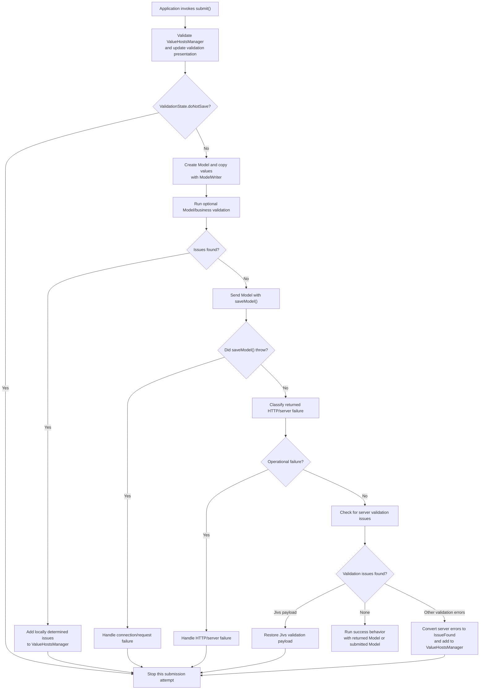

#### Client API submission: happy path

This focused path consolidates all unsuccessful request outcomes into one departure. [R01](#r01--client-pre-submission) and [R02](#r02--api-submission-result-handling) expand the client steps. Preparation does not imply that a Model is required for every workflow.

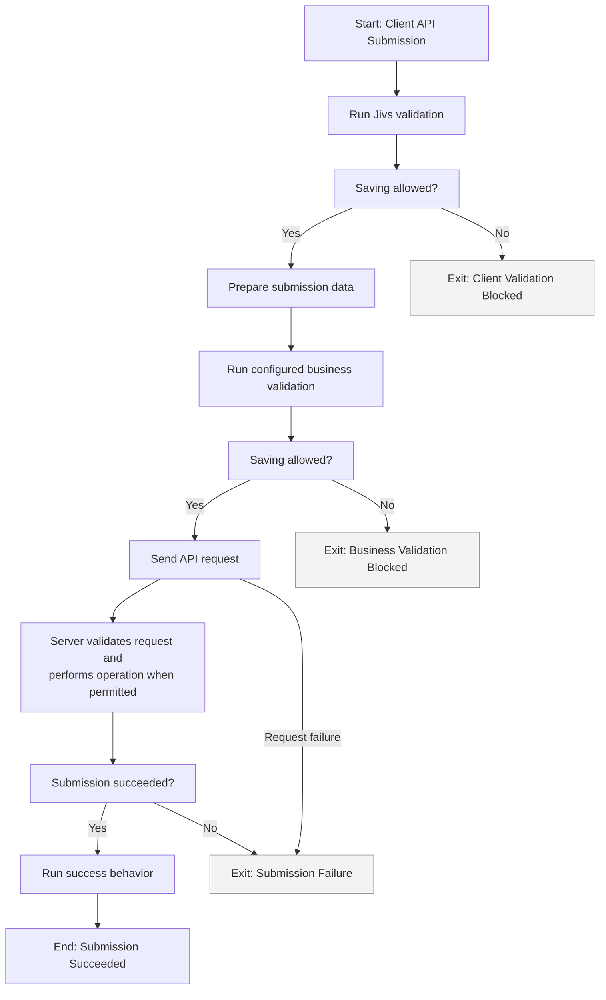

### V02 — Client posting a form and receiving a server-generated page

The current page runs [R01](#r01--client-pre-submission), captures Jivs state, and submits the form. For this native-post workflow, jivs-dom can wire the form submission through a `submit` role presentation (Q36). The server determines the outcome. A validation-blocked response leads to V03; the existing page does not process that response as an API result.

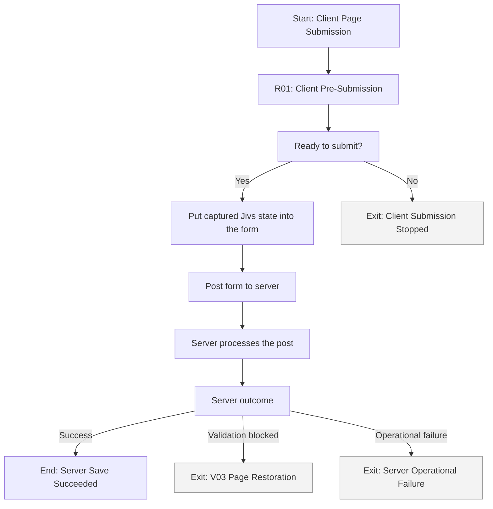

### V03 — Server-generated page containing restoration setup

For a validation-blocked save, the server returns the submitted captured state unchanged, the server issues, and the setup for restoring them. The new page restores the manager, connects presentation, reconciles the regenerated editors, and applies the issues. This continuation also applies to non-Node.js servers; the [server-pages guide](../docs/Learning_Jivs/Server_Pages/Server_pages_workflow_page_save.md) needs updating to reflect the reconciliation decision.

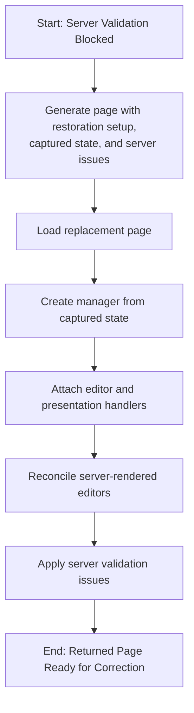

Transport encoding and safe presentation of the issues remain open (T05 and Q04).

### V04 — Node.js server handling an API request

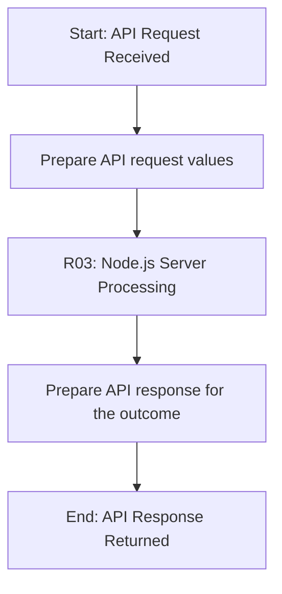

The API response contract determines how success, validation issues, and operational failures are represented.

### V05 — Node.js server handling posted form data

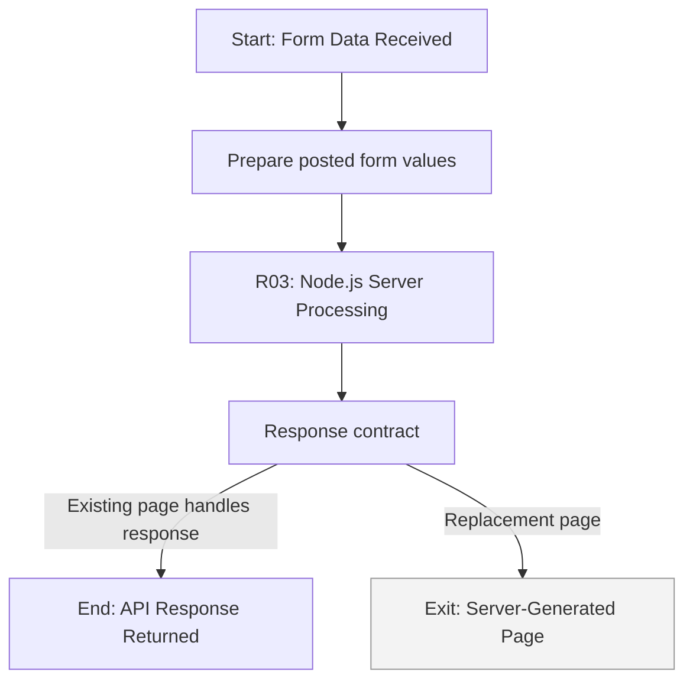

When a replacement page returns validation issues and restores Jivs state, continue with V03. A form-data API response instead belongs to the existing-page lifecycle in V01.

## Reusable workflows

### R01 — Client Pre-Submission

This workflow covers the client steps before handing off submission, including paths that stop the attempt. V01 and V02 reuse it. The Jivs submitter validates and checks the entire manager, not a validation group (Q62). Business validation is optional; when it runs, the orchestration prepares a Model using `ModelWriter` (T01). The business-validation hook is to be async (Q02).

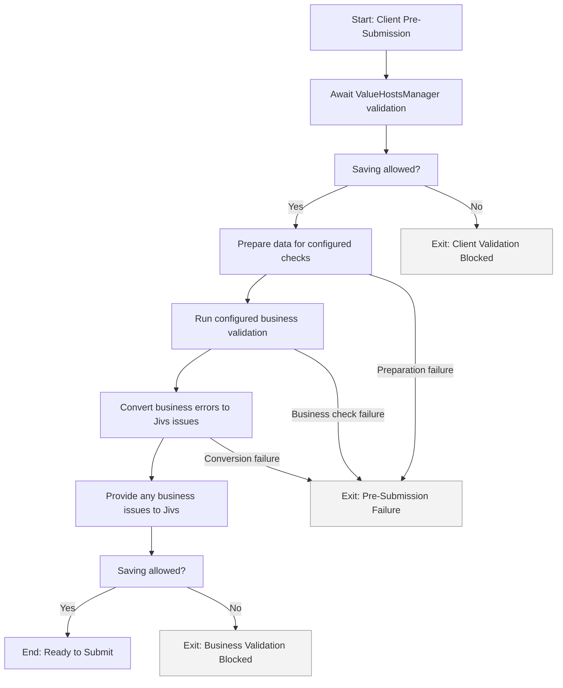

Jivs validation waits for participating host completions. A failed or obsolete manager call currently returns a blocking state; Q15 plans to distinguish these outcomes. Submission calls and awaits `validate()` without a separate pre-check for already-running validation (Q18). The business-validation hook returns application errors; orchestration uses `IExternalIssueConverter` to convert them (Q11). Business issues are added to Jivs, and submission continues when the resulting validation state permits saving, including when it contains non-blocking warnings (Q10). The starter helper currently stops for any returned issue. The planned workflow retries stale pre-submission work (Q13 and Q14) and reports unexpected failures through a Jivs issue before rejecting (Q53 and Q54); details remain for design.

### R02 — API Submission Result Handling

This workflow handles an API submission on the existing page, including a request that does not return a response. It expands the consolidated **Submission Failure** departure in the V01 happy path. Response classification, including validation returned with a non-success status and unexpected or empty responses, remains open (Q03 and Q05).

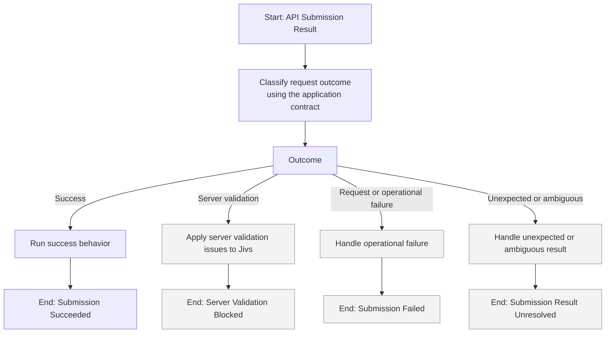

Jivs server payloads are restored through `fromValidationPayload()`; errors from another validation system are converted and added as externally determined issues. Encoding directions are recorded in Q04, Q24, and Q66; remaining usage-setting details are in Q25. The design must distinguish request and operational failures from validation issues, while considering the Validation Summary as a possible way to notify the user of an operational failure.

### R03 — Node.js Server Processing

This candidate reusable workflow is shared by V04 and V05 after request-specific preparation. It does not prescribe a server package or replace independent server validation. The operation itself may also discover validation issues or fail operationally.

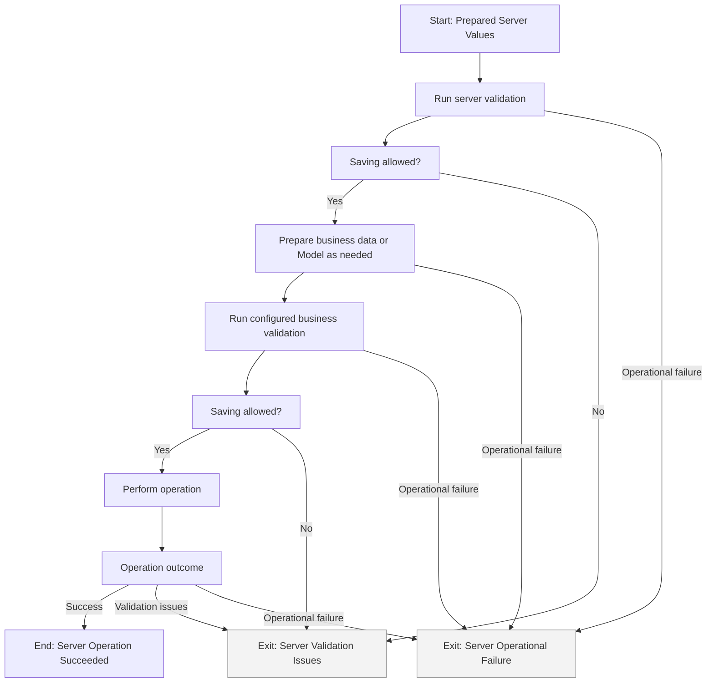

V04 and V05 prepare the response appropriate to each outcome. The existing [server-side guidance](../docs/Learning_Jivs/Understanding_Server_Side_Validation.md) should remain useful for applications that cannot use a Node.js server package and should be reviewed where the design exposes flaws.

## Relationship to the current guide and helper

The sequence in the [submission guide](../docs/Learning_Jivs/Submitting_the_Client_Form.md) is reflected in the [starter helper](../starter_code/jivs-DOM_helpers.ts): validate, build the Model, optionally run business validation, send, handle failures and server validation, then succeed. The helper makes application-specific actions overrideable and supplies separate server-validation subclasses for Jivs payloads and other error formats.

The helper also distinguishes locally determined client issues from externally determined server issues:

- Business-validation issues are passed to `addExternalIssuesFound()` as locally determined. The manager's validation callbacks can then update the existing client validation presentation.
- Errors imported from another validation system are passed as externally determined. As described in the guide, these can be cleared by a later client-side validation attempt.
- A Jivs validation payload is restored through the manager, which likewise updates the validation state and presentation.

The client uses Jivs validation as its gate before submission, but it does not replace authoritative server-side validation.

## Further planning notes

- **Async operations.** The business-validation hook is to be async (Q02), so submission must await it before sending. `saveModel()` already returns a promise in the starter helper. `ValueHostsManager.validate()` awaits participating validation work; submission calls it without a separate pre-check for already-running validation (Q18). Q15 plans to distinguish obsolete runs from unexpected failures.
- **Submission outcomes.** The planned `submit()` resolves with explicit outcomes for a validation-blocked or already-running attempt (Q51 and Q54). Unexpected pre-submission failures and exhausted retries reject after the agreed user notification; unexpected failures are logged (Q52–Q55). Exact result and error shapes remain for design; API response handling remains deferred.
- **Server pages.** Separate classes are likely to be needed for the client post and client refresh sides. The post path may not need a Model and sends captured Jivs state with the form. A returned page creates and restores its own manager before applying server issues; see [Server Pages Workflow: Page Save](../docs/Learning_Jivs/Server_Pages/Server_pages_workflow_page_save.md).
- **Business-validation warnings.** Warnings are intended to be non-blocking, consistent with the `doNotSave` check after Jivs validation. The starter helper instead stops whenever business validation returns any issues, so that behavior needs revision. For external issues, Jivs defaults warning `doNotSave` to false but honors an explicitly assigned value. Warnings are best associated with field-level issues where possible: a warning discovered during submission may be lost to the user if the process continues successfully, unless another blocking issue keeps the user on the form.
- **Response handling.** The handling of empty or ambiguous responses, including a Jivs validation payload containing an empty issue list, remains to be determined.

## Topics still to decide

Use T numbers for discussion topics and Q numbers for individual questions.
Existing questions Q01-Q66 retain their numbers; the next new question is Q67.

- **T01 — Model requirement and workflow boundaries.** Design the Model factory and writer extension points; preserve the decisions to skip an unnecessary native-post Model and leave reconciliation with posted controls to the application (Q32–Q35).
- **T02 — Business validation and warnings.** Plan the async business-validation hook (Q02), conversion of application errors to Jivs issues, and how non-blocking warnings affect submission.
- **T03 — Submission lifecycle and concurrency.** Design the remaining result, error, and retry details around the decisions on overlapping attempts, pre-submission changes, and in-flight requests (Q12–Q19 and Q51–Q55).
- **T04 — Response handling and success criteria.** Consider validation returned with a non-success HTTP status (Q03) and how to reject unexpected or ambiguous responses rather than treating them as success (Q05).
- **T05 — Payloads and presentation.** Determine safe handling of messages displayed as HTML (Q04), including the encoding of Jivs payloads and transport in server-generated pages. Consider empty or ambiguous validation payloads.
- **T06 — Server-page and server workflows.** Define the boundaries between an existing client page calling an API, a native form post that replaces the page, the returned page's restoration process, and server-side validation and response preparation. Include guidance for non-Node.js servers.

### Review findings to discuss

These are issues or gaps identified in the planning review; resolutions are recorded with their topics. API response classification remains deferred.

- **T07 — Grouped submission and model-level issues (resolved for the Jivs submitter).** Q21 treats an ungrouped ValueHost as matching any requested group when clearing external issues, but the current grouped `doNotSave` calculation uses `groupCheck()`, which does not match an ungrouped ValueHost to a named group. 

**SOLVED**: Q62 resolves this for the Jivs submitter by requiring whole-manager validation and save checks, rather than group-scoped submission. This does not change grouped validation or the clearing decisions for other uses. See [`calculateDoNotSave()`](../packages/jivs-engine/src/Validation/ValueHostsManager.ts) and [`groupCheck()`](../packages/jivs-engine/src/ValueHosts/ValidatableValueHostBase.ts).

- **T08 — External-issue clearing during restoration (resolved).** Q20's proposed default clearing could remove restored external issues during startup: `ServerPageValuesReader.read()` calls `valuesInitialized()`, which starts preliminary manager validation. See [`ServerPageValuesReader`](../packages/jivs-dom/src/Editors/ServerPageValuesReader.ts) and [`valuesInitialized()`](../packages/jivs-engine/src/Validation/ValueHostsManager.ts).

**SOLVED**: `ValueHostsManager.validate()` must not automatically clear external issues when `ValidateOptions.preliminary` is `true`. Non-preliminary validation clears them by default, with the Q20 retain option still available. Add a round-trip test covering a restored external issue on an unchanged field, and tests for preliminary and non-preliminary clearing behavior.

- **T09 — Native submit-event interaction (skipped for now).** The Q36 binding prevents the original submit event and later calls `requestSubmit()`, which dispatches another submit event. Other listeners can run twice, and Jivs's own `preventDefault()` makes cancellation of the original event by another listener difficult to distinguish. Define the integration contract for other listeners and cancellation without assuming the illustration is a final implementation.
- **T10 — Freshness tracking and Jivs-created ValueHosts (resolved).** Q13 proposes tracking ValueHost identities and checking freshness around business validation and handoff. Adding a model-level business issue can itself create a `ModelValidatorsValueHost`; detecting all additions could mistake that creation for a user edit and retry unnecessarily. See [`addExternalIssueFound()`](../packages/jivs-engine/src/Validation/ValueHostsManager.ts).

**SOLVED**: Compare only the hosts captured at the start; newly added hosts do not trigger a retry (Q63). Applications are not intended to add ValueHosts after initialization, with the exception of `ModelValidatorsValueHost`. This host holds issues rather than a value; although it inherits `changeCounter`, its counter is fixed. Keeping its counter when the host already exists at snapshot time is harmless. Test that its later creation does not trigger a retry.

- **T11 — Visibility of submission failure messages (resolved).** Q52 and Q53 use a Jivs issue for the Validation Summary, but an application may not install a summary, and grouped presentations may not respond to a particular validation notification. See [`FormPresentationBase`](../packages/jivs-dom/src/FormPresentations/FormPresentationBase.ts).

**SOLVED**: Mark external `IssueFound` objects so applications can build a Validation Summary that displays only those issues. Recommend and document that applications keep an appropriate presentation available, including how to use the marker and how to provide an alternative such as a popup. Applications own this presentation; jivs-dom need not provide an external-only summary (Q65). External issues can include business warnings and ordinary server validation, not just unexpected submission failures, so filtering by origin alone would show those too. A configured presentation is still needed for visibility, including consideration of group filtering. An issue aligned to a local validator does not retain the external marker (Q64); the exact marker API remains for design.

- **T12 — Message format for the `IssueFound[]` converter (resolved).** Q60 proposes a converter for existing `IssueFound` objects, while Q04 notes that Jivs-generated messages may already contain prepared HTML.

**SOLVED**: Document that messages supplied to an external issue converter, including an `IssueFound[]` from business validation, are plain text and not already HTML-encoded. Converters encode messages for client HTML presentation; browser helpers must not encode them again (Q66). Server-side conversion leaves messages as plain text. This contract also applies to custom `IExternalIssueConverter` implementations. The Jivs Validation Payload path remains separate.

- **T13 — Stale overview and planning notes (resolved).** The overview and planning notes now reflect the planned asynchronous outcomes, the Q18 no-pre-check decision, and the warning behavior, while identifying descriptions of the existing starter helper.

**T07 decision:** The Jivs submitter validates the whole manager and checks the whole manager after business validation; it does not support group-scoped submission. Recommend separate `ValueHostsManager` instances for independently saved models. This supersedes Q38's earlier decision to use a native submit button's group. Group validation remains available for other application workflows; applications remain free to build their own submission workflows. Separate managers add setup and require applications to handle any shared data or cross-section rules. Native posts still send browser form controls rather than a Model, and the application remains responsible for their relationship to the manager (Q33).

When modeling native-post wiring, consider how a grouped submit-button presentation's enabled state relates to whole-manager submission; do not assume they already use the same scope. Test that a Jivs submission cannot bypass blocking issues in another group or at model level.

**Documentation follow-through:** Update user-facing validation-group guidance when this work is implemented, and carry this requirement into subsequent design and implementation documents. Explain that the Jivs submitter validates the entire manager, recommend separate managers for independently saved models, and retain guidance on groups for other validation and presentation uses. Existing guidance explicitly describes groups for separate submit commands, including [Configuring ValueHosts](../docs/API/ValueHosts/Configuring_ValueHosts.md), [Invoking Validation](../docs/API/Validators/Invoking_Validation.md), and [Jivs API](../docs/Jivs_API.md); review the related [validation options API comments](../packages/jivs-engine/src/Interfaces/Validation.ts) as well.

## Discussion: T06 server-page startup

The shared page-startup assistance needs to cover both initial page load and a page returned after server validation fails. Initial load reads editor values. A validation return restores submitted state and reconciles the regenerated editors: unchanged values retain their restored state, while server-changed values are read and reset for preliminary validation. Server issues are applied after reconciliation.

Still to discuss:

- What shared startup assistance Jivs supplies.
- What server-side integration Jivs offers for Node.js and other server technologies.
- How application-specific rules and the element collector are supplied to startup code (Q06).

The application generally supplies its own `ValueHostRulesBase` subclass. Startup must be able to construct or otherwise obtain the configured rules. It also needs an element collector: `SimpleDomElementCollector` is a common provided implementation, while an application may supply its own. The user-defined rules and any custom collector must be available to the client-side startup code; generating generic boilerplate alone does not identify or import them.

The emerging `startServerPage()` configuration includes `containerIdentifier` and an optional `activeCultureId`, rather than a general manager-options object or a `behaviors` parameter. Startup supplies the identifier to `ValueHostsManagerConfig`; for this workflow it must identify the form used for the post.

**Behaviors across a round trip:** `behaviors.activeCultureId` affects parsing, formatting, and validation messages and may change during the manager's lifetime. The current manager's `captureState()` does not preserve behaviors. Update `ValueHostsManager` instance state and captured state to retain all current behaviors (Q57). Restore captured behavior values in preference to rules-configured values and defaults. Startup must establish the effective culture before reading regenerated editors: an explicitly supplied `startServerPage()` `activeCultureId` overrides the captured culture; otherwise use the captured culture, rules-configured culture, or culture service default, in that order (Q09). Older captured states without behaviors fall back to the rules or defaults.

### Proposed `startServerPage()` responsibilities

The server-generated page calls Jivs-supplied client startup code for both initial load and a validation-failure return. The application supplies its rules, any custom collector, and any non-Jivs error converter. The function, its parameter names, and the converter API below are planning illustrations, not implemented APIs.

The proposed `startServerPage()` is a convenience wrapper around a worker class. Applications needing customization could instantiate their own worker instead of using the wrapper. The worker's relationship to submission orchestration and its extension points remain to be designed.

| Parameter | Intended role |
| --- | --- |
| `containerIdentifier` | Required selector copied to `ValueHostsManagerConfig`. It must resolve to the actual `<form>` so a captured-state input inside it participates in the post. Fail explicitly if the selector is absent, invalid, does not resolve, or does not select a form; do not silently fall back to `document.body`. |
| `services` | Required application-supplied Jivs services instance, already configured for jivs-dom (Q56). |
| `createRules` | Required application-supplied factory that receives configured Jivs services and creates the form's rules. It makes the application's rules class and any dependencies available to client startup. |
| `collector` | Illustrative optional application-selected `IElementCollector`. `SimpleDomElementCollector` is a possible default; custom collectors remain supported. The parameter's exact form is open. |
| `capturedState` | Optional opaque string supplied by the page: empty or omitted for initial load; non-empty to restore a returned page. It is not a request to parse or modify the opaque state in application code. |
| `serverIssues` | Optional serialized server issues supplied by the page. A Jivs payload and another system's errors use different handling; the non-Jivs converter receives this string (Q07). |
| `issueConverter` | Illustrative application-supplied converter for non-Jivs server errors. A Jivs-supplied base class and its interface are planned; construction and startup integration details remain design work (Q07). A Jivs payload uses `fromValidationPayload()` instead. |
| `activeCultureId` | Optional culture supplied by an application that manages culture independently. It overrides the captured culture; when omitted, use the captured culture, rules-configured culture, or service default (Q09). Other behaviors are not startup parameters. |

The application supplies the services instance already configured for jivs-dom before the rules, manager, and installer use it (Q56). `startServerPage()` returns the resulting manager for use throughout the form's lifecycle (Q59). The native-post binding API and the exact way to select the server-issue handler also remain design work. The native-post wiring direction is described in Q36; API submission does not require an HTML form (Q01).

The intended startup sequence is:

1. Use the application-supplied Jivs services to create the application rules and configuration. Validate `containerIdentifier` against the actual form and supply it to the configuration.
2. Select initial or restoration setup using `capturedState`: empty means initial; non-empty means restore. Restore captured behaviors when available and apply the optional `activeCultureId` override before initializing editors (Q09 and Q57). Non-empty malformed state must be reported, not silently treated as an initial page.
3. Create the `ValueHostsManager`, install jivs-dom with the selected collector, and initialize editor values. For a restored page, `ServerPageValuesReader` reconciles server-rendered changes while preserving unchanged values and their validation state.
4. Create the two hidden inputs in the form when absent, or reuse existing inputs and overwrite their values from the startup parameters. Apply returned server issues after the manager and presentation are ready (Q08).

The existing [Page Save guide](../docs/Learning_Jivs/Server_Pages/Server_pages_workflow_page_save.md) describes server-rendered hidden inputs. The direction above instead has `startServerPage()` create them, with the server supplying returned values to its call. The guide will need to be updated once the design is settled.

### Server-page transport inputs

- `_jivsCapturedState` is a named hidden input inside the form. It starts empty on initial load. Immediately before a save post, submission code assigns `vhm.captureState()`. On validation failure, the server returns that same opaque string to the replacement page's `startServerPage()` call.
- `_jivsServerIssues` holds the serialized validation information for the returned page: either a Jivs Validation Payload or errors from another validation system. The application-specific converter handles the latter.

The server must independently validate the posted form data; captured state is for client restoration, not a substitute for server validation. Creating the inputs alone does not populate captured state at post time. The native-post submission workflow does that immediately before posting; its planned jivs-dom event binding is described in Q36.

An empty or omitted captured-state value selects initial setup. A non-empty value selects restoration. Startup trusts the server's contract: if the server accidentally omits both returned values, the client cannot distinguish that from an initial load. Document this limitation rather than adding a separate marker.

When the server determines there are no validation errors, it chooses how to prepare the resulting page and may provide captured state or omit it. Providing it restores state; omitting it selects initial setup. Empty server issues do not by themselves imply save success.

The reserved input names belong to this workflow. Startup reuses existing inputs and sets their values from its parameters, or creates them if absent. Do not add defensive duplicate-name or input-type checks; the application is responsible for using the reserved names appropriately.

### Server-generated startup examples

These are illustrative calls to the proposed API, not existing exports. The application bundle at `/scripts/person-form.js` must export `startServerPage`, its configured `personServices`, `PersonFormRules`, and `PersonServerIssueConverter`; module and bundle configuration is application-owned. These examples use a non-Jivs server, so the converter represents application-specific error handling (Q07).

On initial load the server supplies empty strings. After validation failure it supplies the posted captured-state string unchanged and its server issues as a **serialized string**. The server must encode each complete string as a JavaScript literal safe inside an HTML `<script>` element. Do not insert raw values, use HTML attribute encoding as JavaScript escaping, or apply HTML escaping to the resulting JavaScript literal.

#### ASP.NET MVC / Razor

```cshtml
@using System.Text.Json

<form id="personForm" method="post">
    <!-- Application editors and presentation elements -->
</form>

<script type="module">
    import { startServerPage, personServices, PersonFormRules, PersonServerIssueConverter }
        from "/scripts/person-form.js";

    startServerPage({
        containerIdentifier: "#personForm",
        services: personServices,
        createRules: services => new PersonFormRules(services),
        issueConverter: new PersonServerIssueConverter(),
        capturedState: @Html.Raw(JsonSerializer.Serialize(Model.CapturedState ?? "")),
        serverIssues: @Html.Raw(JsonSerializer.Serialize(Model.ServerIssues ?? ""))
    });
</script>
```

`Model.CapturedState` and `Model.ServerIssues` are server-side strings; the application supplies empty strings for initial load. `JsonSerializer.Serialize` produces the complete quoted JavaScript literal. This example relies on its default encoder, which escapes HTML-sensitive characters; do not use relaxed escaping or apply `Html.Raw` to an unserialized value.

#### PHP

```php
<form id="personForm" method="post">
    <!-- Application editors and presentation elements -->
</form>

<script type="module">
    import { startServerPage, personServices, PersonFormRules, PersonServerIssueConverter }
        from "/scripts/person-form.js";

    startServerPage({
        containerIdentifier: "#personForm",
        services: personServices,
        createRules: services => new PersonFormRules(services),
        issueConverter: new PersonServerIssueConverter(),
        capturedState: <?= json_encode($capturedState ?? '',
            JSON_HEX_TAG | JSON_HEX_AMP | JSON_HEX_APOS | JSON_HEX_QUOT | JSON_THROW_ON_ERROR) ?>,
        serverIssues: <?= json_encode($serverIssues ?? '',
            JSON_HEX_TAG | JSON_HEX_AMP | JSON_HEX_APOS | JSON_HEX_QUOT | JSON_THROW_ON_ERROR) ?>
    });
</script>
```

`$capturedState` and `$serverIssues` are strings supplied by the application; they are empty on initial load. The `JSON_HEX_*` flags protect HTML-sensitive characters in the inline script, and encoding errors throw rather than generating a success-shaped value. If server errors originate as an object, the application first serializes them into the error-format string; encoding that string for the JavaScript literal is a separate step.

For a Jivs server payload, startup uses `fromValidationPayload()` instead of requiring a non-Jivs converter. A server may also deliver a shared client script by another mechanism, but it must safely supply the per-response values. Non-Node.js servers do not require a Jivs server package. Security and message presentation remain part of T05.

### Shared conversion of external validation errors

For a non-Jivs server, A02 and A03 both need to convert application-specific server errors to `IssueFound[]`. A02 may receive already-decoded errors in an API response; A03 first receives serialized errors in `_jivsServerIssues`. Application business validation can also produce errors requiring conversion. The application's error format determines how decoding and mapping work.

The planned `IExternalIssueConverter` interface exposes one operation, `convert`, which accepts a string, array, or object along with an `IValueHostsManager` and returns `IssueFound[]`. The manager supplies the active culture and Jivs services. A02 and business validation can pass decoded data; `startServerPage()` supplies the serialized string. Input messages must be plain text, not already HTML-encoded. Converters, including custom implementations, are responsible for encoding output messages for client HTML presentation and leaving them plain text for server use (Q66). The application-specific converter can be tested independently of the DOM, using a manager.

Provide a Jivs-supplied converter for arrays that already contain `IssueFound` objects, so business validation can use the same conversion contract without requiring an application-written converter (Q60). Exact handling of existing issue properties remains for design.

A Jivs-supplied generic base class orchestrates conversion and lets the application subclass it for its error format:

1. If the input is a string, deserialize it. The default uses JSON and can be overridden. Prepare the decoded or directly supplied input as an array of the original errors. `TError` represents those errors; an application can use a union, `object`, or `any` for heterogeneous data.
2. Invoke an abstract application method for each original error to produce an `IssueFound`.
3. Post-process each issue with mapping, localization, and appropriate message encoding, retaining access to its original error for overridable resolution methods. Resolve the Jivs error code first, so message and severity resolution can use it. Encode both message fields for client HTML presentation after resolving their plain-text content; do not encode for server use (Q66).

The planned mappings and resolution behavior are:

- **Error code:** A default mapping converts a source code to a Jivs code. An overridable resolver can instead consider other source details, such as a message or the containing object.
- **Error message:** Support regular-expression-to-result mapping, with an overridable resolver receiving the resolved Jivs code and original error. Localize the resolved message using `ErrorMessagesService` and the manager's active culture; the mapped message is the fallback when no localized message is found.
- **Summary message:** Do not provide a separate mapping. Post-processing assigns the resolved error message as the summary message.
- **Severity:** Map the resolved Jivs code to Severe or Warning as desired. Leave severity undefined when there is no mapping; an ordinary external issue then defaults to Error. An explicit mapping may lower severity, including to Warning.
- **ValueHost name:** Match source names case-insensitively and map them to the exact destination names.

The exact mapping APIs, missing-mapping behavior, data-type lookup, and message-token processing remain for detailed design. An error code is not necessarily a registered condition type, so looking up or constructing a condition to infer severity is not assumed.

Conversion is all-or-nothing: a valid empty collection returns `[]`; malformed input, an unrecognized structure, or failed conversion throws rather than returning an empty or partial result. Complete conversion before calling `addExternalIssuesFound`, so a conversion failure does not itself trigger replacement of existing issues. This is separate from the planned clearing at the start of non-preliminary manager validation (Q20). Document application-owned handling of startup conversion errors (Q07); unexpected pre-submission failures use the shared Jivs failure issue (Q53).

Once converted, server issues are added with `addExternalIssuesFound(issuesFound, false)`; client business issues use `determinedLocally: true`. An explicit `doNotSave` and validator alignment can affect the resulting behavior. Existing validator alignment is approved: when an issue aligns with a validator, validator handling may replace its messages and use its severity unless the issue explicitly supplies one. A Jivs Validation Payload instead follows the existing `fromValidationPayload()` path and does not require the external converter. Message encoding is addressed in Q04 and Q24.

## Discussion: requiring a Model

Peter's direction is for the submission orchestration to provide a Model to business validation, using `ModelWriter` to populate it after Jivs validation. A Model encourages separation between application business logic and Jivs and can make it possible to share that business logic between the client and a Node.js server. The orchestration needs a way for the application to create the initial Model container and may also need to allow a custom writer.

The strongest case is Model-based business validation: the same application validation function can operate on a Model without requiring a `ValueHostsManager`. Sharing still depends on compatible Model types, rules, dependencies, and runtime behavior; constructing a Model alone does not guarantee that the same code can run in both environments.

For a native form post, the browser sends form controls rather than the Model created by `ModelWriter`. Without a configured client business-validation hook, skip Model creation (Q32). When business validation checks a Model, the application is responsible for ensuring that any differences between that Model and the posted controls are acceptable; Jivs does not reconcile them (Q33). The server independently validates the received data.

`ModelWriter` can populate a plain object or a mutable class instance. It iterates FieldValueHosts, not Model properties; additional Model properties without corresponding FieldValueHosts are not examined. A FieldValueHost's `propertyName` supports nested paths, but their parent objects and array elements must already exist. For a FieldValueHost being written, a missing destination property on a class instance is logged as an error; a missing parent is logged as a warning. The current `write()` returns no result, so orchestration cannot directly identify these unsuccessful writes.

The missing-destination cases logged by `setValueIntoExternalData()` indicate bugs that developers should fix before production. Submission will rely on existing logging and continue if such a case occurs at runtime (Q29). Other writer behaviors, including intentional skips and unregistered adapter rules, remain for design.

When a Model is needed, orchestration supports an application-supplied factory and defaults to a new plain object (Q34). It also supports a custom writer and defaults to `ModelWriter` (Q35). The extension point's exact API and the relationship to the server-page worker remain for design.

## Discussion: changes during pre-submission

The proposed direction for Q13 is to repeat pre-submission validation when relevant values change while it is running, rather than continue with an obsolete Model or business-validation result:

1. At the start of an attempt, capture the identities and `changeCounter` values of the existing ValueHosts. Compare those captured hosts on later checks; changes, removals, or replacements of captured hosts need detection, but newly added hosts do not trigger a retry (Q63).
2. Await `ValueHostsManager.validate()`, then check the snapshot before using the result or creating the Model. The manager already protects its own validation run against relevant changes.
3. If the inputs are current and Jivs permits saving, prepare the Model and run async business validation. Recheck after Model preparation and after the business check, before converting or applying its results.
4. If inputs changed, discard the stale result and repeat from Jivs validation. If inputs remain current, handle any blocking issues or continue toward submission. Recheck as needed before the handoff, including when application callbacks can change values.

The snapshot is temporary submission bookkeeping, not captured instance state. Keeping it local to the submission worker is a suggestion; whether the manager should offer shared tracking assistance remains a design question.

Automatic retry can run business validation more than once. Limit retries using a globally configurable setting with a default of five retries after the initial attempt; when the limit is reached, stop and notify the user (Q14). The settings API and notification details remain for design. `validate()` currently returns a blocking state for both obsolete runs and unexpected failures. Extend its result to report those outcomes distinctly, including when both occur, so submission does not retry an unexpected failure as if it were only stale work (Q15).

Rather than introduce a special message for retry exhaustion, use a shared, configurable failure error code and fallback message for failures outside validation evaluation. Follow the existing `asyncValidation.failedToResolveErrorCode` and `failedToResolveErrorMessage` pattern: applications can override the fallback and localize through `ErrorMessagesService`. Keep technical failure details available for diagnostics rather than presenting them to the user. The settings location, the scope of failures sharing the message, and the mechanism for reporting the outcome remain for design. This does not change the decision that startup conversion errors throw and applications can catch them.

Tracking ValueHosts only detects changes that reach Jivs. A native form post sends the actual controls, which may contain edits not yet reflected in `setTextValue()`. The application is responsible for ensuring editor changes reach Jivs before submission, including shortcut or programmatic submission and uncommitted edits made during async validation (Q19). For a client API request already sent, the user may continue editing; those edits belong to the next edit-and-submit cycle and must not be overwritten by the orchestration (Q16). Do not add special handling for potentially stale server issues after such edits (Q17). Native form-post handoff has different page-lifecycle considerations.

## Design questions

### Q01 — Form submission trigger

Should the client abstraction only expose the submission operation, as the starter helper does, or should it also provide DOM submit-event wiring?

**Peter's original decision:** Event-handler wiring is outside the submission abstraction. If provided, it comes through other code.

**Refinement:** For the native form-post workflow, jivs-dom can supply DOM event wiring through a `submit` role FormPresentation and a shared form binding (Q36). This does not require an HTML form for API submissions, and does not mandate that applications use Jivs event wiring for their own workflows.

### Q02 — Asynchronous business validation

The documented and starter-helper business-validation hooks are synchronous. Should the design support business checks that need to await other application services?

Peter's decision: make `validateModelBeforeSave()` async. `saveModel()` is already asynchronous.

### Q03 — Validation returned with a non-success HTTP status

The helper checks HTTP failure before checking server validation. For an existing API that uses a non-success status for validation, its HTTP-failure handler must recognize that case and allow the server-validation step to run, or the planned order must change. Which behavior should the design establish?

When looking at the code in Jivs-dom_helpers.ts, it offers three interceptors that take the response and return true if they handle it. handleHttpFailure() should be able to address how the user wants to proceed. However, if you see a flaw, let me know.

Review: `handleHttpFailure()` can let a validation response continue to `handleServerIssues()`. If the HTTP library throws for a non-success status, however, `saveModel()` must distinguish and return the validation response; otherwise the helper sends the exception to `handleConnectionFailure()`.

### Q04 — Jivs payload encoding

The helper restores a Jivs payload without an encoder, while the server-side guide describes passing an encoder when validation messages will be displayed as HTML. How should the client submission API make that option available?

I am unclear on where and what encoding is happening on the server's payload. Also not sure if you are talking about jivs own payload or errors in the API's own shape.

Review: This question concerns the Jivs Validation Payload. The server's `toValidationPayload()` serializes issues as JSON. The optional encoder on the client's `fromValidationPayload()` applies to each imported `errorMessage`, not to the whole payload or to `summaryMessage`. This is separate from encoding the payload for transport, such as embedding it in an HTML attribute. A non-Jivs API's errors instead pass through the application's conversion path. The design still needs to establish safe handling for all messages displayed as HTML.

Decision: External issue messages are plain text; the existing documentation does not explicitly promise HTML support for messages supplied by external sources. Both `errorMessage` and `summaryMessage` need safe handling when displayed in HTML. Existing Jivs-generated messages are different: they may already contain Jivs-prepared HTML around tokens, so their handling must not assume every message in a Jivs payload is plain text. Validator alignment may replace an external message with a locally generated validator message.

Agreed engine fix: when an encoder is supplied to `fromValidationPayload()`, apply it to both `errorMessage` and any supplied `summaryMessage`. Preserve the existing optional-encoder behavior and the summary's fallback to `errorMessage` when absent. Add focused tests and update the API comments and server-side guidance.

Decision: When the new submission wrapper calls `fromValidationPayload()`, it uses the `JivsGlobalSettings` usage setting to decide whether to supply the built-in HTML encoder (Q27). This does not change the existing method's optional encoder for other callers.

The current HTML formatter preserves either message verbatim. Handling external errors passed through the separate converter is addressed in Q24; server-side message formatting is addressed in Q25. Safe serialization into server-generated JavaScript remains a separate transport concern.

### Q05 — Success criteria

The base helper proceeds to success if neither failure hook stops processing and no server validation is found. The response contract or subclass behavior therefore needs to define how unexpected or ambiguous responses are rejected. Where should that responsibility live?

TBD

### Q06 — Supplying application-specific startup dependencies

How will generated or shared startup code obtain the application's rules and element collector, while keeping the developer's required setup approachable for both Node.js and non-Node.js servers?

The current direction is for the server-generated page to call `startServerPage()` directly, using an application bundle that makes the rules and any custom collector available. The application supplies configured services (Q56) and a rules factory; the collector is optional, with `SimpleDomElementCollector` as a possible default. The precise module and collector contracts remain open.

### Q07 — Shared server-error conversion

What responsibilities and extension points should the shared converter base class provide for application-specific server errors, including the boundary between decoding and conversion?

**Peter's decision:** Use the single-operation `IExternalIssueConverter` interface and a testable, user-subclassed generic base class, reusable for server and client business errors. It accepts a string, array, or object and the manager; deserializes strings with overridable JSON-default behavior; converts prepared source errors; and post-processes them with mapping and localization. Conversion failures throw, with application-owned error presentation documented. The mapping, localization, and alignment direction is described in **Shared conversion of external validation errors**; API details remain for formal design.

### Q08 — Selecting server-page startup mode

The current direction uses empty `capturedState` for initial load and non-empty `capturedState` for restoration. How should startup handle missing, inconsistent, or invalid inputs, including existing hidden inputs and a return where the server accidentally omitted both values?

**Peter's decision:** Use captured state to select the mode and trust the server contract; document that an accidental omission of both returned values cannot be detected. Reuse existing hidden inputs and overwrite their values from startup parameters, or create them when absent. Do not add defensive duplicate-name or input-type checks. When there are no server validation errors, the server chooses the resulting page and may provide captured state for restoration or omit it for initial setup.

### Q09 — Retaining active culture

How should a server-generated page retain or establish the appropriate `behaviors.activeCultureId` across a post and returned-page restoration? Consider the current captured-state limitation and precedence if the application supplies a different culture.

**Peter's decision:** Update captured state to retain the active culture. It must be established before startup reads editor values. Use this precedence: explicit `startServerPage()` `activeCultureId`, captured culture, rules-configured culture, and culture service default. Older captured states without a culture fall back to the rules-configured culture or service default. Q57 extends state retention to all behaviors.

### Q10 — Business warnings during submission

Should the presence of a business-validation warning stop submission?

**Peter's decision:** Add business issues to Jivs and continue when the resulting validation state's `doNotSave` is false, even when it contains warnings.

### Q11 — Converting business-validation errors

Should the business-validation hook return `IssueFound[]` and invoke `IExternalIssueConverter` itself when needed, or should it return application errors for orchestration to convert? The converter can be reused for both business and server errors; its name is not limited to server use.

**Peter's decision:** The business-validation hook returns application errors, and orchestration invokes `IExternalIssueConverter` to convert them. Applications can use different converter instances for business and server error formats. Provide a converter for arrays already containing `IssueFound` objects (Q60).

### Q12 — Overlapping submission attempts

Should a second submit start another workflow while the first is still running?

**Peter's decision:** Allow only one submission workflow at a time. This covers the full operation, not just `ValueHostsManager.validate()`: the manager already handles concurrency for its own validation runs, but business validation and server communication also need protection from overlapping attempts. Release the guard when an attempt stops or fails so a later attempt can proceed. A submitter instance can be retained for the form's lifecycle to manage multiple attempts; for a native post, release the guard when `requestSubmit()` returns (Q41). A second caller receives an explicit already-in-progress outcome (Q51); its exact shape remains for design. The jivs-dom native-post wiring direction is described in Q36.

### Q13 — Edits during pre-submission

How should submission handle changes after validation begins but before the Model and business-validation results are used?

**Direction for design:** Track ValueHost identities and value change counters, discard obsolete results, and retry pre-submission with current values. See **Discussion: changes during pre-submission** for checkpoints. Q15 addresses distinguishing obsolete validation from unexpected failures; Q19 addresses editor values not yet reflected in Jivs.

### Q14 — Repeated changes during validation

How should automatic retries behave if values keep changing during pre-submission?

**Peter's decision:** Limit retries and notify the user when the limit is reached. Provide a global setting with a default of five retries after the initial attempt; the application can choose a different limit. Use a shared configurable and localizable failure message rather than a message specific to retry exhaustion.

### Q15 — Identifying validation run outcomes

How can submission distinguish an obsolete manager validation run from an unexpected failure when both currently return a blocking `ValidationState`?

**Peter's decision:** Extend the `validate()` result to report whether the run became obsolete and whether it failed, including when both occurred. Submission can then retry stale work without treating an unexpected failure as an ordinary retry. The result shape, compatibility, and handling details remain for design; ordinary validation issues remain distinct from an unexpected run failure.

### Q16 — Edits while an API request is in flight

Should editing be prevented after an API request has been sent?

**Peter's decision:** Allow editing. The request belongs to the submitted Model; subsequent edits are part of the next edit-and-submit cycle. The orchestration must not overwrite those newer edits.

### Q17 — Server issues after newer edits

Should the workflow specially handle server validation issues returned after the user edits the form?

**Peter's decision:** Do nothing special for this case. Do not add response-staleness tracking or suppression; use normal response handling.

### Q18 — Validation already in progress

Should submission check for an already-running async validator before calling `ValueHostsManager.validate()`?

**Peter's decision:** No separate pre-check. Call and await `validate()` and rely on the engine's existing rules for reusing, restarting, or skipping participating async validation.

### Q19 — Editor values not yet reflected in Jivs

Should submission synchronize editors whose current values have not yet reached their ValueHosts?

**Peter's decision:** The application is responsible for ensuring editor changes reach Jivs. This includes shortcuts or programmatic submission that do not trigger the usual change event, and uncommitted edits made while async validation runs. Do not add automatic editor synchronization to submission for this case; document the responsibility.

### Q20 — External issues at the validation boundary

How should a new manager validation run handle external issues left from an earlier attempt, including business issues that could otherwise block a new business check?

**Peter's direction:** Make `ValueHostsManager.validate()` start fresh by clearing external issues by default, except when `ValidateOptions.preliminary` is `true`: preliminary validation must not automatically clear them (T08). Add a validation option for non-preliminary calls that need to retain those issues. This avoids assigning lifecycle ownership to individual external issues. Applications must understand that a non-preliminary validation call normally removes earlier external issues from matching hosts and arrange to determine any still-applicable issues again; manager validation itself does not run application business rules. Group scope is addressed in Q21; the option's name, notifications, and compatibility with existing callers remain for design. Cover preliminary retention, default clearing, and the retain option in tests; update validation API documentation.

### Q21 — Grouped validation and external issues

When manager validation targets a group, should it clear external issues outside that group?

**Peter's decision:** Update `ValueHostsManager.clearExternalIssuesFound(options)` to honor `options.group` and clear only external issues on matching ValueHosts. An unspecified, empty, or `'*'` group matches all groups, including an ungrouped ValueHost matching a named requested group. Thus ungrouped model-level issues also match any group; when manager validation clears issues for all groups, it clears external issues across all hosts. Preliminary validation does not automatically clear them (Q20).

This clearing rule differs from the current `ValueHost.groupCheck()`, which substitutes `'.'` for an unspecified host group and therefore does not match a named group. `IssueFound` currently has no group property; the clearing decision uses the ValueHost's group. How to implement the match and whether any other group behavior should change remain for design.

### Q22 — Group-aware replacement of external issues

Should `ValueHostsManager.addExternalIssuesFound()` clear issues outside `options.group` before adding the new issues?

**Peter's decision:** Use the same group-aware clearing rule as Q21 when replacing external issues, including the match-all rule for ungrouped ValueHosts. The current implementation clears external issues across all hosts regardless of `options.group`. Group affects clearing only, not the addition of supplied issues (Q23).

### Q23 — Adding issues outside the requested group

Should `addExternalIssuesFound()` filter supplied issues based on `options.group`?

**Peter's decision:** No. Group is used only for clearing previous external issues; adding supplied issues is unrelated to that group.

### Q24 — Encoding converted external messages

Where should HTML encoding of converted external messages occur for browser submission and server-page startup?

**Peter's decision, refined by Q66:** Converters HTML-encode both `errorMessage` and any supplied `summaryMessage` for client HTML presentation. Browser helpers do not encode the converted output again. Server-side conversion leaves the messages as plain text. This is separate from the Jivs Validation Payload path in Q04.

### Q25 — Server-side message formatting

How should a Jivs server avoid producing HTML-encoded messages that browser-side processing will encode again?

**Peter's direction:** Add a usage setting to `JivsGlobalSettings`, corresponding to the `usage` parameter of the starter `createJivsServices()` function, and assign it there. Make `AsyncValidator` respect that setting: server use should not HTML-encode its message before the payload is transferred. Retain appropriate HTML safety for client use. The setting's precise API, defaults, and `'all'` behavior remain for design; coordinate them with the message-token resolver configuration.

Server-side setup must use the server configuration so synchronous validators also use the plain-text token resolver. The current server-side guide calls `createJivsServices('en-US')`, which defaults to client usage, and needs to be updated. Cover server and client async message handling and payload round trips in tests, including messages containing HTML-sensitive characters.

### Q26 — Failure while restoring a Jivs payload

Should `fromValidationPayload()` clear existing external issues before parsing and preparing the incoming payload?

**Peter's decision:** No. Parse the payload, check its shape, and encode its messages before clearing existing external issues. If parsing, shape checking, or encoding fails, propagate the error and preserve the earlier issues. Add focused tests and update the API documentation. The meaning of an empty payload in a submission response remains separate; `toValidationPayload()` currently produces JSON `null` when there are no issues.

### Q27 — Jivs payload on server-page startup

Should server-page startup supply an HTML encoder when restoring a Jivs payload?

**Peter's decision:** Yes. Both server-page startup and the API submission wrapper use the `JivsGlobalSettings` usage setting (Q25) to decide whether to supply the built-in HTML encoder to `fromValidationPayload()`. The exact setting API and behavior for each usage remain for design.

### Q28 — Restoring a payload with no issues

How should `fromValidationPayload()` handle a valid empty issue set?

**Peter's decision:** Treat both JSON `null` and an empty array as valid empty issue sets. Clear earlier external issues, return whether the validation state changed, and notify the manager's validation-state callback when it did. Currently `toValidationPayload()` produces JSON `null` when no issues exist; restoring an empty issue set can clear existing issues but return false without the manager callback. Add focused tests and update the API documentation. This engine behavior does not determine whether an empty payload means a submission succeeded.

### Q29 — Detecting failed Model writes

Should submission detect failed writes and stop before business validation or sending, or rely on existing logging for these development-time bugs? See **Discussion: requiring a Model**. Extra Model properties without FieldValueHosts are not examined and are not failed writes.

**Peter's decision:** For the missing-destination cases logged by `setValueIntoExternalData()`, retain the existing logging and continue submission. These are bugs developers should fix before production, not validation issues for the end user.

### Q30 — Misleading writer success log

Should the writer log a successful assignment after `setValueIntoExternalData()` could not find the destination?

**Peter's decision:** Fix the misleading log: report assignment success only when the assignment happened. Add focused tests for failed destination lookup and successful assignment. This does not change Q29's decision to continue submission.

### Q31 — Writer result after a failed assignment

Should `setValueWithRule()` and `writeField()` return false when a destination assignment fails?

**Peter's decision:** Yes. A failed destination assignment currently results in true despite the documented meaning of a successful write. Correct the result and test it along with Q30. Bulk `write()` does not use this result, so submission continues as decided in Q29.

### Q32 — Model for a native form post

Should a native form post create a Model when client-side business validation is not configured?

**Peter's decision:** No. Skip Model creation in that case; native form submission sends the form controls. A Model is still prepared when needed for client business validation. API submission can create a Model when its request needs one.

### Q33 — Model versus posted controls

When client business validation uses a Model, who handles differences between that Model and the controls sent by a native form post?

**Peter's decision:** The application is responsible for ensuring those differences are acceptable. Jivs does not attempt to reconcile the Model and posted data; the server independently validates what it receives.

### Q34 — Creating the Model

How should submission create a Model for `ModelWriter`?

**Peter's decision:** Allow the application to supply a Model factory; when none is supplied, create a plain object. Create a fresh Model for each pre-submission attempt. `ModelWriter` can add missing properties to a plain object, but does not create missing nested parent objects or array elements; applications needing those structures can supply an initialized Model through the factory. The exact factory API remains for design.

### Q35 — Customizing the Model writer

Should submission allow the application to customize the writer that populates the Model?

**Peter's decision:** Yes. Support supplying or creating a custom writer, with `ModelWriter` as the default. The precise extension API remains for formal design.

### Q36 — Native form-post handoff

How can jivs-dom connect a native form submission to the submission workflow and initiate the post after pre-submission succeeds?

**Peter's direction:** Scope this DOM integration to jivs-dom. Use a FormPresentation on the `submit` role as the likely integration point, so Jivs can set up the submission wiring and resume the native post. This refines Q01 for the native form-post workflow. API calls do not require an HTML form; an API request using form data is not necessarily a native form post.

The following examples illustrate the direction, not implemented exports or final API names. The application marks the submit control and starts the server-page workflow:

```html
<form id="person-form" method="post" novalidate>
    <!-- editors -->
    <button type="submit" data-jivs-role="submit">Save</button>
</form>
```

```ts
const vhm = startServerPage({
    containerIdentifier: '#person-form',
    services: personServices,
    createRules: services => new PersonFormRules(services),
    // Native-post submission configuration
});
vhm.submitter = new PersonSubmitter();
```

Jivs-dom could register a native-submit presentation with the existing form-presentation factory. How it is configured or selected for this workflow remains for design:

```ts
factory.register('NativeSubmit', element =>
    new NativeSubmitPresentation(element, options));

factory.setDefaultPresentationName(ElementRole.submit, 'NativeSubmit');
```

The presentation can retain the existing submit-button state behavior and obtain a shared binding for its form. `getFormForSubmitElement` and `nativePostBindings` below represent proposed facilities:

```ts
class NativeSubmitPresentation extends SubmitButtonPresentation {
    override init(vhm: IValueHostsManager): void {
        super.init(vhm);

        const form = getFormForSubmitElement(this.element);
        const binding = nativePostBindings.getOrCreate(form, vhm);
        binding.registerSubmitElement(this.element);
    }
}
```

The binding installs one submit-event listener per form. After validation and captured-state preparation, it resumes the native post without starting the submission workflow again:

```ts
// Inside the shared native-post binding
private onSubmit(event: SubmitEvent): void {
    if (this.resumingNativePost)
        return;

    if (event.submitter && !this.isRegisteredSubmitter(event.submitter))
        return;

    event.preventDefault();

    void this.submission.submit({
        submitter: event.submitter,
        onReady: () => {
            this.resumingNativePost = true;
            try {
                this.form.requestSubmit(event.submitter ?? undefined);
            }
            finally {
                this.resumingNativePost = false;
            }
        }
    }).catch(error => this.reportFailure(error));
}
```

The workflow must perform the agreed freshness checks and capture state before the handoff; avoid introducing an asynchronous gap between the final check and initiating the post. `requestSubmit()` fires another submit event and preserves the submitter when supplied; other listeners can still cancel that event. The Jivs submitter validates the entire manager whether or not a recognized submit button initiated the post (Q62). A submitter not registered with Jivs is application-managed (Q40). Release the submission guard after `requestSubmit()` returns (Q41); binding cleanup remains for design. Direct `form.submit()` bypasses submit events, so the binding cannot intercept it.

### Q37 — Model writer destination extension points

How can a `ModelWriter` subclass customize destination handling for class-based Models without replacing the global `objectFinderService` or the whole write operation?

**Peter's direction:** Extract destination lookup into an overridable protected method whose default uses `objectFinderService.find()`. A subclass can call the default lookup, prepare a known missing parent if appropriate, and retry. Also provide an overridable decision for whether a missing property may be created on the resolved object, preserving the existing default behavior. Exact names and signatures remain for design.

The finder does not distinguish an invalid path from a missing parent, so custom recovery should be limited to paths the application recognizes. Preserve failure logging and the Q30/Q31 success-log and return-value corrections. Consider compatibility with existing subclasses when changing the return contract of `setValueIntoExternalData()`.

### Q38 — Validation group for the native submitter

When a recognized submit button initiates a native post, should its validation group be used for manager validation?

**Superseded decision:** The earlier direction was to pass the submit button's group to `ValueHostsManager.validate()`. Q62 replaces it: the Jivs submitter validates the entire manager regardless of the button's group.

### Q39 — Native submission without a submitter

Which validation group should the native-post binding use when a form submit event has no submitter?

**Peter's decision:** Validate all groups. Q62 extends whole-manager validation to recognized submit buttons as well. This does not decide the behavior when a submitter exists but is not managed by Jivs.

### Q40 — Submitter not managed by Jivs

What happens when a form submit event has a submitter that is not registered with jivs-dom as a `submit` role?

**Peter's decision:** A participating button can be registered as a `submit` role; the application may need to make its `ElementCollector` aware of unusual cases. Otherwise, the submitter workflow is application-managed, and the application can call the submitter object itself. Do not automatically treat an unregistered submitter as a Jivs-managed submit button. This is separate from the no-submitter case (Q39).

### Q41 — Submitter instance and native-post guard

How should a submitter instance manage attempts across the form lifecycle, especially after handing a native post to the browser?

**Peter's direction:** Recommend retaining a submitter instance for the lifecycle of the form, so it can manage multiple attempts rather than creating a new instance for each one. The native-post binding and participating submit controls should use that shared instance.

**Peter's decision:** Hold the guard through the native `requestSubmit()` call, then release it, including when the page remains open because the submitter workflow was cancelled. The browser does not return the server response to the submitter object, so Jivs cannot reliably keep the guard until native-post completion. Another post can begin while navigation is pending; preventing duplicate server operations remains the server's responsibility. API submissions are different: the submitter object can await the request outcome.

### Q42 — Accessing the manager and shared submitter instance

How should application and jivs-dom code discover and share the submitter instance?

**Peter's direction:** The `ValueHostsManager` must be exposed throughout the form's lifecycle. Do not assume that `startServerPage()` owns or returns the submitter object: it is specific to server-generated pages, whereas API submissions do not have an equivalent startup function.

**Peter's decision:** `SubmitterBase` does not receive the `ValueHostsManager` in its constructor. The application constructs its subclass, then assigns it to the public `submitter` property on the manager:

```ts
const submitter = new PersonSubmitter();
vhm.submitter = submitter;
```

This replaces the earlier separate `registerSubmitter` proposal and the earlier constructor-attachment proposal; do not introduce that public registration API. The manager-owned property is the typed discovery and attachment mechanism for application code and jivs-dom. Exact initialization and how this fits `startServerPage()` remain for design. The approach must also work for API submission without requiring a form.

A broader form-lifecycle orchestration object remains exploratory, not a decision to merge submission with startup or introduce a common startup API. Property assignment avoids a separate registration API that might complicate a later orchestration approach.

### Q43 — Preventing competing submitter instances

Should an application be able to call `submit()` on an instance other than the one attached to its `ValueHostsManager`?

**Peter's decision:** No. Before starting a workflow, `submit()` must verify that it is the instance assigned to its manager. An unattached or different instance reports a configuration error instead of running. This prevents a second instance from bypassing the shared workflow guard. Attachment occurs through `vhm.submitter = submitter` (Q42); error-reporting details remain for design.

### Q44 — Attaching a second instance

Should a new submitter instance replace a different instance already attached to the manager?

**Peter's decision:** No. Reject the new instance rather than replacing the attached one. Any explicit replacement or reconfiguration API remains for later design.

### Q45 — Submission lookup timing

When should the native-post binding obtain the submitter instance attached to the manager, particularly if `startServerPage()` installs presentations before exposing the manager? Looking it up at submit time was proposed, but remains undecided. Attachment now occurs when the application assigns `vhm.submitter` (Q42), not during `SubmitterBase` construction or through a separate registration call.

**Peter's direction:** This detail is not worth deciding separately. The binding can obtain or defer lookup of the attached submitter instance as needed, provided startup can establish or expose the manager and submitter before native submission is attempted.

**Peter's decision:** Defer exact lookup timing. Preserve a documented, typed way to retrieve the submitter instance; do not require presentation initialization to construct or register the submitter. A manager property is the preferred possibility now that `SubmitterBase` may become a first-class type in jivs-engine.

### Q46 — Submission retrieval API

How should application code and jivs-dom retrieve the submitter instance attached to a `ValueHostsManager`?

**Peter's direction:** If `SubmitterBase` is a first-class member of jivs-engine, consider adding a typed retrieval function on `IValueHostsManager` or another manager-owned API. The function must support the attachment and second-instance rules in Q42-Q44 without introducing a separate registration operation.

**Peter's decision:** Prefer a manager member implemented as a getter/setter property if `SubmitterBase` becomes first-class. Before assignment, the getter returns `null`; after assignment, assignment throws rather than replacing the instance. The application assigns the submitter to the manager property. The property is public and uses `ISubmitter`; the property name is `submitter`.

### Q47 — Submission property interface and visibility

What should the public submission property on `IValueHostsManager` expose, and what interface should represent it?

**Peter's decision:** Make both the getter and setter public. Use the nongeneric `ISubmitter` interface rather than exposing `SubmitterBase` or a generic base type. The property is named `submitter`; the setter may only attach a valid submitter and throws after a submitter is already attached.

### Q48 — Submission terminology

Should the first-class abstraction and manager property continue to use “Submission” terminology, or move to “Submitter” terminology?

**Peter's direction:** Consider aligning the public names with `submitter` and a possible `ISubmitter` / `SubmitterBase` pair.

**Peter's decision:** Rename the first-class abstraction to `SubmitterBase` and `ISubmitter`. Rename the manager property to `submitter`. General workflow and native-post concepts remain described as “submission.”

### Q49 — Failed submitter subclass construction

How should the manager clean up or avoid attachment if construction of a derived `SubmitterBase` subclass fails before it is assigned to `vhm.submitter`?

**Peter's direction:** Treat this as an application construction/setup failure rather than a specialized submission-lifecycle state. Normal object creation and property assignment do not require cleanup of every later possible use; consumption happens only after construction is complete.

**Peter's decision:** Defer automatic rollback and detach infrastructure. A subclass constructor that throws is a developer/setup error, and no property assignment occurs. Attachment is not a runtime submission workflow to recover from. Normal startup constructs a valid submitter before assigning it to the manager.

### Q50 — Attaching the manager to a submitter

How can `SubmitterBase` access its `ValueHostsManager` after the application assigns `vhm.submitter = submitter`?

**Peter's decision:** Use the following approach: the manager setter establishes the bidirectional link. `ISubmitter` includes an attachment method for this operation, while `SubmitterBase` stores the manager privately and exposes it through a protected getter for subclasses. This sketch illustrates attachment; submission options and result types are not yet decided:

```ts
export interface ISubmitter {
    attachValueHostsManager(manager: IValueHostsManager): void;
    submit(options: SubmitterOptions): Promise<SubmitResult>;
}

export abstract class SubmitterBase implements ISubmitter {
    private _valueHostsManager: IValueHostsManager | null = null;

    protected get valueHostsManager(): IValueHostsManager {
        if (!this._valueHostsManager)
            throw new Error('Submitter is not attached to a ValueHostsManager.');
        return this._valueHostsManager;
    }

    public attachValueHostsManager(manager: IValueHostsManager): void {
        assertNotNull(manager, 'manager');

        if (this._valueHostsManager &&
            this._valueHostsManager !== manager)
            throw new Error('Submitter is already attached to another ValueHostsManager.');

        this._valueHostsManager = manager;
    }

    public abstract submit(options: SubmitterOptions): Promise<SubmitResult>;
}

export class ValueHostsManager
    implements IValueHostsManager {

    private _submitter: ISubmitter | null = null;

    public get submitter(): ISubmitter | null {
        return this._submitter;
    }

    public set submitter(submitter: ISubmitter | null) {
        if (this._submitter)
            throw new Error('This ValueHostsManager already has a submitter.');
        if (!submitter)
            return;

        submitter.attachValueHostsManager(this);
        this._submitter = submitter;
    }
}
```

This does not require `SubmitterBase` to receive `IValueHostsManager` in its constructor. The protected getter keeps normal application code on `ISubmitter`, while subclasses can access the attached manager. The attachment method is public on `ISubmitter`; exact naming remains for design. The sketch does not yet implement the `submit()` ownership and concurrency checks required by Q12 and Q43.

### Q51 — Notification of overlapping attempts

How should a second caller be notified when it attempts submission while the shared submitter is already running a workflow (Q12)?

**Peter's decision:** Return an explicit already-in-progress outcome to the second caller; do not interrupt the first attempt. This does not automatically show a message to the user or add a Jivs issue. The caller, including a native-post binding, can decide how to respond. The exact result shape remains for design.

### Q52 — Notifying the user when retries are exhausted

How should submission notify the user when repeated edits exhaust the pre-submission retry limit (Q14), using the shared configurable and localizable failure message?

**Peter's decision:** Add a Jivs issue for display in the Validation Summary. The issue is not associated with a particular field; the manager's existing external-issue routing can direct it to the model-level ValueHost. Exact issue construction and reporting details remain for design.

### Q53 — Unexpected pre-submission failures

Should unexpected failures during pre-submission also stop the attempt and use the shared failure message and Validation Summary notification (Q14 and Q52)?

**Peter's decision:** Yes. Stop the attempt and add the shared Jivs failure issue for the Validation Summary. Log technical details rather than showing them to the user. This does not change Q29: the writer's logged missing-destination failures continue without stopping submission.

### Q54 — Reporting a validation-blocked attempt to the caller

When client or business validation blocks submission, should `submit()` return an explicit blocked outcome to its caller, in addition to presenting the validation issues through Jivs?

**Peter's decision:** `submit()` will be asynchronous. Resolve with an explicit blocked outcome for ordinary validation errors; reject for unexpected failures, using an `Error` or another object containing details. Unexpected failures are logged and their user-oriented message delivered to the UI before rejection (Q53). Retry exhaustion also rejects (Q55); the already-in-progress outcome is addressed separately in Q51. Exact result and error shapes remain for design.

### Q55 — Reporting exhausted retries to the caller

Should exhaustion of the pre-submission retry limit resolve with a distinct outcome or reject the `submit()` promise?

**Peter's decision:** Reject with details about retry exhaustion. The shared Jivs failure issue is shown in the Validation Summary as decided in Q52.

### Q56 — Services for server-page startup

How should `startServerPage()` obtain the configured Jivs services needed by the rules, manager, and jivs-dom installer?

**Peter's decision:** Require the application to provide an already-configured services instance, including jivs-dom configuration. Startup uses that instance rather than creating default services.

### Q57 — Retaining manager behaviors

How should manager behaviors be retained across a server-page round trip, and what should startup allow the application to override?

**Peter's decision:** `ValueHostsManager` retains all its behavior properties in instance state, including in captured state for restoration. `startServerPage()` has no `behaviors` parameter; it offers only `activeCultureId` for applications that retain their own culture. Captured behavior values take precedence over rules and defaults; the explicitly supplied startup culture is the exception and overrides captured culture (Q09). When captured values are absent, use rules values and then defaults.

The current manager constructor fills some behavior defaults, so restoration must distinguish captured values from defaults and preserve compatibility with older states without behaviors. The exact state shape and merge implementation remain for design.

### Q58 — Malformed captured state at startup

How should `startServerPage()` report a non-empty captured-state value that it cannot restore?

**Peter's decision:** Throw an error for the application to handle. Do not silently treat malformed captured state as an initial page. Document application-owned error handling.

### Q59 — Exposing the manager after server-page startup

How should `startServerPage()` expose the manager so application code can use it and assign its submitter?

**Peter's decision:** Return the manager directly.

### Q60 — Business validation that produces Jivs issues

Should applications whose business validation already returns `IssueFound[]` be able to supply those issues directly, without an external-issue converter?

**Peter's decision:** Keep the converter-based contract. Provide a Jivs converter for arrays of `IssueFound` objects so applications with that format do not need to write their own.

### Q61 — Enabling optional business validation

How should a submitter know whether the application has configured business validation, so a native post can skip Model creation when it is not needed (Q32)?

**Peter's direction:** Defer this until the submitter class and its usage are modeled. Preserve Q32's requirement to skip Model creation for a native post when client business validation is not configured.

### Q62 — Scope of a Jivs submission

Should the Jivs submitter always validate and save the entire `ValueHostsManager`, leaving independently saved models to separate managers rather than supporting group-scoped submission?

**Peter's decision:** Yes. The Jivs submitter validates the entire manager and checks the whole manager's validation state after business validation; it does not offer group-scoped submission. Recommend separate managers for independently saved models. This supersedes Q38, but leaves group validation available for other application workflows and does not prevent applications from implementing their own submission workflows. Update validation-group user documentation and retain that requirement in later design and implementation documents (T07). The application remains responsible for what an API request or native form post sends (Q33).

### Q63 — Model-level issue host in freshness tracking

Should pre-submission input-freshness tracking treat a `ModelValidatorsValueHost` created after the snapshot as a change requiring a retry?

**Peter's decision:** No. Compare only the ValueHosts captured at the start; newly added hosts do not trigger a retry. If `ModelValidatorsValueHost` already exists, retaining its fixed counter in the snapshot is harmless.

### Q64 — External issue origin after validator alignment

Should an externally supplied issue retain an external-origin marker if it aligns with a local validator and is converted into that validator's issue shape?

**Peter's decision:** No. An external issue whose error code matches a validator activates that validator rather than representing a one-off external error. Do not copy the external marker into the validator's `IssueFound`; preserve the existing validator-owned lifecycle.

### Q65 — External-only Validation Summary

Should jivs-dom provide an external-only Validation Summary, or should applications use the external marker to build their own presentation?

**Peter's decision:** Leave the external-only presentation to applications. Document the marker and recommend that applications keep an appropriate presentation available, including the possibility of a popup.

### Q66 — Encoding converted external messages once

Should converter post-processing or the browser helpers be responsible for HTML-encoding converted external messages?

**Peter's decision:** The converter owns HTML encoding; browser helpers do not encode its output again. The converter base class performs it during post-processing for client HTML presentation, while server-side output remains plain text. The built-in `IssueFound[]` converter and custom `IExternalIssueConverter` implementations must follow the same contract. Document that input messages are plain text and test HTML-sensitive characters in both message fields, including that output is encoded only once.

---
Note that I think jivs-dom_helpers.ts is a great starting point for coding. I could just move it right now into jivs-dom. Yet this work is looking for flaws, variations, and other use cases to ensure we have it correct.