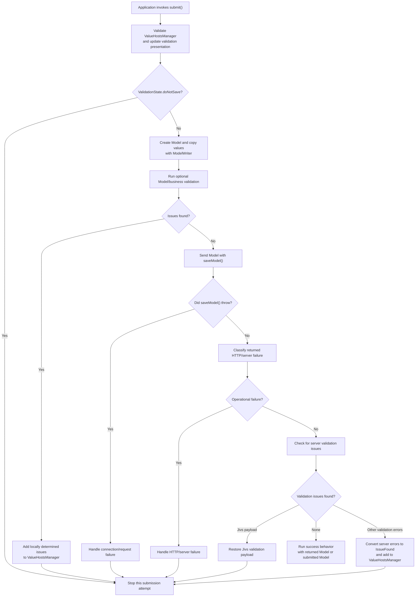

# Client-Side Submission Workflow

## Purpose and status

This document records the initial understanding of the client-side submission workflow, based on the existing [submission guide](../docs/Learning_Jivs/Submitting_the_Client_Form.md) and [starter helper classes](../starter_code/jivs-DOM_helpers.ts).

The goal is to describe the purpose of each action and its stop conditions clearly enough to compare a future implementation against the intended workflow. This is an initial planning document, not a coding guide; the questions at the end remain open for Peter's review.

## Workflow overview

The submission class orchestrates the sequence and decides when processing must stop. Application-specific behavior remains supplied by subclasses or other application code: model creation, business validation, communication, failure presentation, server-error mapping, and success behavior.

The following sequence describes the starter helper's API-oriented path. The planning notes and questions below identify variations that it does not yet cover.

1. **Start submission.** The application invokes the submission operation. The helper does not attach a DOM submit event; some surrounding application code must call it.

    This is a trigger oriented action. The caller should not expect a response. Internally this process can be async. The developed class should encapsulate all steps to ensure the trigger has no further work.

    We may want to test the validation state for running async process right away and stop. 
2. **Validate the form with Jivs.** Call `ValueHostsManager.validate()` to validate the current form state and update validation presentation through the manager's callbacks. If `ValidationState.doNotSave` is true, stop without building or sending a model.

    By design, the client-side validate() call will cause the UI to refresh all validation state changed elements, whether field or form. That is handled by jivs-dom intercepting the `ValueHostsManager.onValidationState` and `onValueHostValidationState` callbacks.
3. **Build the model.** Create a model and use `ModelWriter` to copy configured FieldValueHost values into it. Field configuration determines the Model property mapping.

    We are imposing a design on the user: they have to build a model if they intend to perform any additional work. When the actual HTTP POST is a API call to the server, the model is a typical form to pass along in JSON. But we must be able to support other processes, including that the server handles the HTML generation ("Server_Pages" in \Learning_Jivs\Server_Pages).

    So we may need to be careful about enforcing a model for our class's needs.
4. **Run optional client business validation.** Check the completed Model for issues not covered by Jivs field validation. If issues are found, add them to the manager as locally determined issues so the existing validation UI can display them, then stop.

    Client business validation needs to be able to convert a foreign error into a jivs IssueFound shape and then pass it through ValueHostsManager.addExternalIssuesFound(). The conversion may become its own object.

    This validation can certainly use the ValueHostManager to directly get values instead of requiring a model. In that case, the business logic is more closely tied to jivs. We would recommend the model as it provides strong separation of concerns and simplifies testing where no ValueHostsManager is needed.
5. **Send the model.** Delegate serialization and communication to the application's `saveModel()` implementation.

    This is the point where Server Pages break from the workflow. They use an HTTP Post and return a fresh page with javascript embedded to tackle the remaining steps, which are likely different than those shown here.
6. **Handle request and HTTP failures.** If `saveModel()` throws, call the application's connection-failure handler and stop. If it returns a response that the HTTP-failure handler classifies as an operational failure, handle it and stop. These failures are distinct from validation errors and should not be added to the validation manager.
7. **Handle server validation.** If the response contains validation issues, put them into the client's Jivs state and stop:
   - With a Jivs server, restore the returned validation payload through through `ValueHostsManager.fromValidationPayload()`
   - With another validation system, convert its errors to `IssueFound` objects and add them as externally determined issues through `ValueHostsManager.addExternalIssuesFound()`
8. **Complete successfully.** If neither failure handler stops the flow, invoke the application's success behavior. The starter helper uses the Model returned by the server when present; otherwise, it uses the submitted Model.

## Workflow diagram

This diagram describes the starter helper, not the separate server-page lifecycle or the proposed changes discussed below.

## Relationship to the current guide and helper

The sequence in the [submission guide](../docs/Learning_Jivs/Submitting_the_Client_Form.md) is reflected in the [starter helper](../starter_code/jivs-DOM_helpers.ts): validate, build the Model, optionally run business validation, send, handle failures and server validation, then succeed. The helper makes application-specific actions overrideable and supplies separate server-validation subclasses for Jivs payloads and other error formats.

The helper also distinguishes locally determined client issues from externally determined server issues:

- Business-validation issues are passed to `addExternalIssuesFound()` as locally determined. The manager's validation callbacks can then update the existing client validation presentation.
- Errors imported from another validation system are passed as externally determined. As described in the guide, these can be cleared by a later client-side validation attempt.
- A Jivs validation payload is restored through the manager, which likewise updates the validation state and presentation.

The client uses Jivs validation as its gate before submission, but it does not replace authoritative server-side validation.

## Further planning notes

- **Async operations.** Consider allowing `validateModelBeforeSave()` to return a promise. `saveModel()` already returns a promise in the starter helper. The submission orchestration would need to await business validation before sending. This is separate from pending async Jivs validators: `doNotSave` is true while they are running, but whether a submission should stop or automatically continue when they finish remains to be determined.
- **Trigger-oriented operation.** The caller should not need a result in order to finish the workflow. The helper's handlers are intended to let the application handle the UI. The handling of errors outside those handlers still needs to be defined for an internally asynchronous operation.
- **Server pages.** Separate classes are likely to be needed for the client post and client refresh sides. The post path may not need a Model and sends captured Jivs state with the form. A returned page creates and restores its own manager before applying server issues; see [Server Pages Workflow: Page Save](../docs/Learning_Jivs/Server_Pages/Server_pages_workflow_page_save.md).
- **Business-validation warnings.** Warnings are intended to be non-blocking, consistent with the `doNotSave` check after Jivs validation. The starter helper instead stops whenever business validation returns any issues, so that behavior needs revision. For external issues, Jivs defaults warning `doNotSave` to false but honors an explicitly assigned value. Warnings are best associated with field-level issues where possible: a warning discovered during submission may be lost to the user if the process continues successfully, unless another blocking issue keeps the user on the form.
- **Response handling.** The handling of empty or ambiguous responses, including a Jivs validation payload containing an empty issue list, remains to be determined.

## Submission workflow variations

Peter identified these variations for the design to consider:

1. **Client-managed page calling an API.** The existing page sends a request and handles the response. The server may use Jivs and return a Jivs Validation Payload, or use another validation system whose errors the client converts.
2. **Client posting a form and receiving a server-generated page.** The existing page validates and posts; a new page then runs the client-side restoration and server-error handling. A form post handled entirely by the existing client page instead belongs with the client-managed API workflow, even when the request uses form data.
3. **Server-generated page containing restoration setup.** The server prepares a returned page with the information and client setup needed after validation fails. This is the server/response side of variation 2, rather than a separate request lifecycle. Servers not using Node.js cannot use a Node.js server package, but still need documentation and integration guidance.
4. **Node.js server handling an API request.** The server prepares the submitted data, runs its own Jivs and business validation, performs the operation, and prepares a response using the application's contract.
5. **Node.js server handling posted form data.** The server prepares and validates form values before the operation. Depending on the response contract, it may return an API response to the existing page or generate a replacement page.

Request encoding (JSON or form data), client page lifecycle (existing or replaced), server validation system (Jivs or another), and response format are separate choices. The design should avoid treating an HTTP form post as inherently equivalent to a page reload or to a particular server technology.

The existing server-side documentation provides a starting point for Node.js and non-Node.js users alike. It should remain useful for applications that cannot use the new server package, and should be reviewed and updated where the design exposes flaws.

## Discussion: requiring a Model

Peter is considering requiring a Model to encourage separation between application business logic and Jivs, and to make it possible to share that business logic between the client and a Node.js server. Creating a Model and filling it with `ModelWriter` is relatively light work. This is a direction for discussion, not yet a decision.

The strongest case is Model-based business validation: the same application validation function can operate on a Model without requiring a `ValueHostsManager`. Sharing still depends on compatible Model types, rules, dependencies, and runtime behavior; constructing a Model alone does not guarantee that the same code can run in both environments.

For a native form post, the browser sends form controls rather than the Model created by `ModelWriter`. A mandatory Model could still serve client business validation, but it might otherwise be unused. If business validation checks the Model while the browser posts the form, the design must also account for differences between the Model values and the actual posted data.

One possible boundary to evaluate is requiring a Model where Model-based business validation or an API request needs one, without assuming that every server-page post must build one. An alternative is to require one uniformly for a simpler, consistent contract. The choice should be tested against the workflows above before settling the class design.

## Design questions

### Q01 — Form submission trigger

Should the client abstraction only expose the submission operation, as the starter helper does, or should it also provide DOM submit-event wiring?

**Peter's decision:** Event-handler wiring is outside this work. If provided, it comes through other code.

### Q02 — Asynchronous business validation

The documented and starter-helper business-validation hooks are synchronous. Should the design support business checks that need to await other application services?

Peter's current direction: consider making `validateModelBeforeSave()` promise-returning. `saveModel()` is already asynchronous.

### Q03 — Validation returned with a non-success HTTP status

The helper checks HTTP failure before checking server validation. For an existing API that uses a non-success status for validation, its HTTP-failure handler must recognize that case and allow the server-validation step to run, or the planned order must change. Which behavior should the design establish?

When looking at the code in Jivs-dom_helpers.ts, it offers three interceptors that take the response and return true if they handle it. handleHttpFailure() should be able to address how the user wants to proceed. However, if you see a flaw, let me know.

Review: `handleHttpFailure()` can let a validation response continue to `handleServerIssues()`. If the HTTP library throws for a non-success status, however, `saveModel()` must distinguish and return the validation response; otherwise the helper sends the exception to `handleConnectionFailure()`.

### Q04 — Jivs payload encoding

The helper restores a Jivs payload without an encoder, while the server-side guide describes passing an encoder when validation messages will be displayed as HTML. How should the client submission API make that option available?

I am unclear on where and what encoding is happening on the server's payload. Also not sure if you are talking about jivs own payload or errors in the API's own shape.

Review: This question concerns the Jivs Validation Payload. The server's `toValidationPayload()` serializes issues as JSON. The optional encoder on the client's `fromValidationPayload()` applies to each imported `errorMessage`, not to the whole payload or to `summaryMessage`. This is separate from encoding the payload for transport, such as embedding it in an HTML attribute. A non-Jivs API's errors instead pass through the application's conversion path. The design still needs to establish safe handling for all messages displayed as HTML.

### Q05 — Success criteria

The base helper proceeds to success if neither failure hook stops processing and no server validation is found. The response contract or subclass behavior therefore needs to define how unexpected or ambiguous responses are rejected. Where should that responsibility live?

TBD

Note that I think jivs-dom_helpers.ts is a great starting point for coding. I could just move it right now into jivs-dom. Yet this work is looking for flaws, variations, and other use cases to ensure we have it correct.