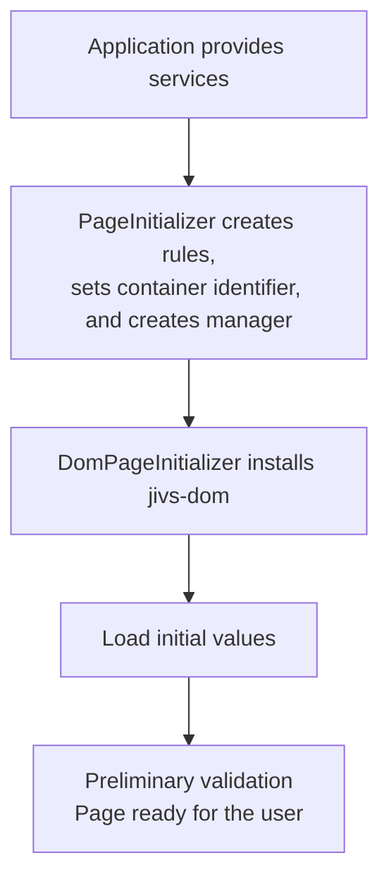
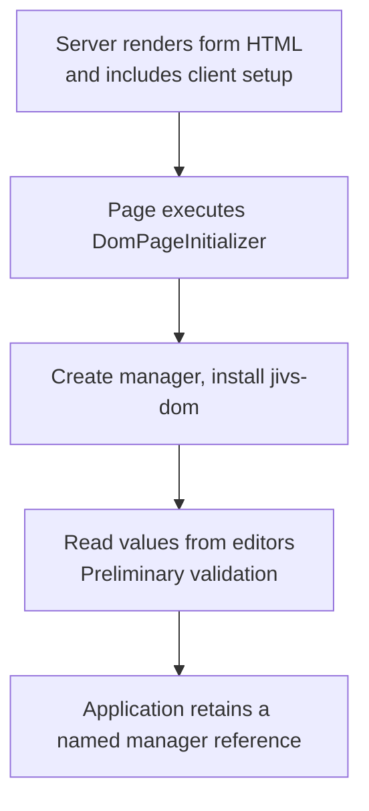
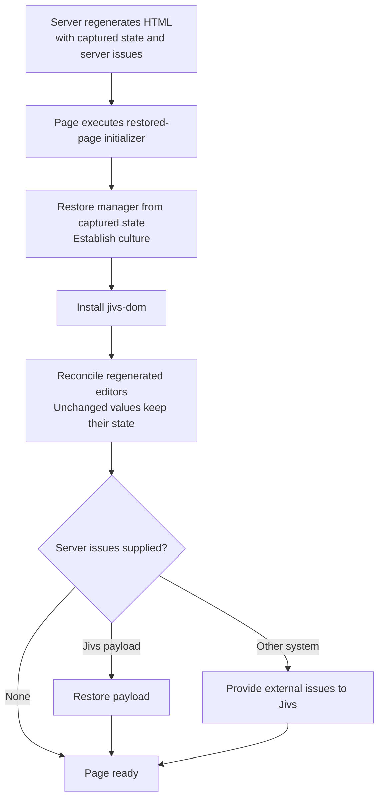
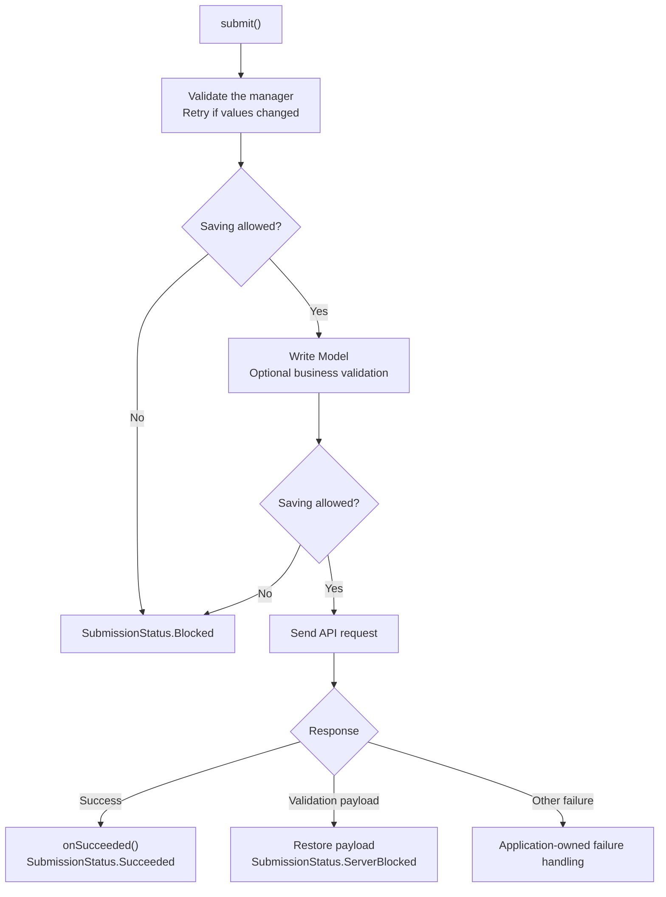
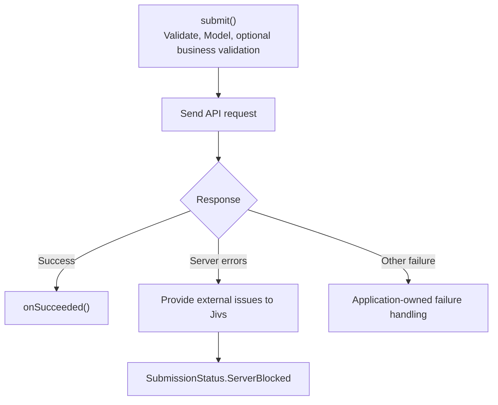
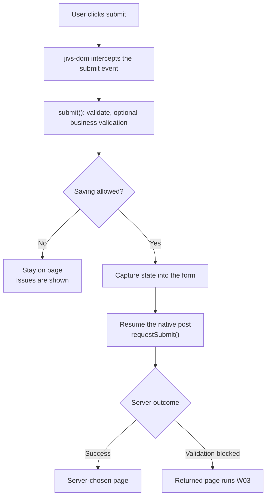
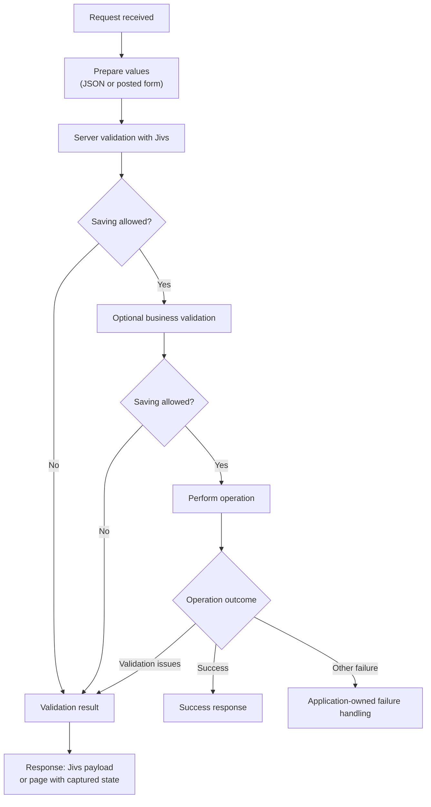

# Workflows Vision

A working vision for Peter and the assistant, not formal documentation. Each section takes a developer through one workflow as end-user documentation would: what it is for, the major steps, how the code looks, and the function or class that wraps it. Names, signatures, and options are sketches to be corrected in discussion before they move into a formal design.

Sources: [Jivs-DOM_Implementation_Design.md](./Jivs-DOM_Implementation_Design.md), [Submission_planning.md](./Submission_planning.md), the [server-pages guide](../docs/Learning_Jivs/Server_Pages/Home.md), and the [starter helpers](../starter_code/jivs-DOM_helpers.ts).

## Conventions in this document

- **Page Initialization** is the Jivs workflow that creates and prepares a `ValueHostsManager` for a page, including both initial setup and restoration. It is not limited to a browser `load` event.
- **`PageInitializer`** is the noun-form name for the abstract class that orchestrates this workflow. DOM and server-page variants specialize it.
- Sketches assume `import`s from the Jivs packages and an application bundle that exports the app's `services`, rules classes, collectors, and converters.
- `PersonFormRules`, `PersonSubmitter`, and similar names are application classes. All names and signatures in this vision are sketches; existing facilities are identified where relevant.
- Each workflow calls out its customization points. The examples should also make clear how an application can compose existing Jivs facilities directly instead of adopting the workflow helper.
- Keep operational and other non-validation failures as a black-box outcome. The application owns their details and presentation.
- Represent public outcome/status values with enums rather than string literals.

| # | Workflow | Main Jivs entry point |
| --- | --- | --- |
| W01 | Page Initialization: client-rendered page | `PageInitializer` base workflow and direct `FormInstaller` / Reader composition |
| W02 | Page Initialization: server-generated initial page | DOM-specific `PageInitializer` variation |
| W03 | Page Initialization: server-generated restored page | DOM-specific `PageInitializer` variation with captured state |
| W04 | Client API submission, Jivs server (A01) | `SubmitterBase` variation |
| W05 | Client API submission, non-Jivs server (A02) | `SubmitterBase` variation with external issue handling |
| W06 | Native form-post submission (A03) | jivs-dom native-post integration |
| W07 | Node.js server processing (V04, V05, R03) | Server-side workflow assistance (shape undecided) |

Round Trip (a non-save server operation that regenerates the page) is W03 with no `serverIssues`; it does not need its own section. Elements Changed (replacing part of the DOM on an existing manager) is out of scope here.

## Proposed object ownership

| Object / responsibility | Proposed package | Notes |
| --- | --- | --- |
| `PageInitializer` base class | jivs-engine | Abstract workflow object. Receives services, executes initialization, and returns a `ValueHostsManager`. It does not need an interface because it is not attached to another object. |
| `DomPageInitializer` subclass | jivs-dom | Extends the engine workflow with `FormInstaller`, element collection, and editor initialization. Server-page initialization is a variation of this workflow. |
| `ISubmitter` / `SubmitterBase` | jivs-engine | The manager owns the attached submitter through its `submitter` property. |
| API / native-post submission behavior | jivs-dom or application code | The manager-level submission contract is in the engine; HTTP and browser form-post integration may be supplied by jivs-dom. |
| Node.js server processing | Undecided | Keep separate from client DOM workflow and ensure non-Node.js servers remain supported through their own request/response code. |

The `PageInitializer` object should expose abstract customization steps for creating rules, a Model when needed, and a submission object when configured. Whether Model/submission creation belongs directly to `PageInitializer` or to a composed submitter remains to be resolved.

The application is responsible for handling errors thrown from within any PageInitializer and Submitter classes.

---

## W01 — Page Initialization: Client-rendered page

### Intro

The application builds its page on the client, or serves static HTML. Jivs connects the form's editors and presentation to a `ValueHostsManager` and loads initial values from a model, dictionary, form data, or the editors themselves. Every other workflow starts from this one.

The workflow vision is an abstract `PageInitializer` base class in jivs-engine, responsible for steps through creating the manager. A jivs-dom subclass adds element collection, installation, and editor initialization. The ordinary client page is the baseline workflow; server-generated-page initialization specializes it. The base class has no need for the submitter-style interface/manager attachment pattern.

The intended application customization points are abstract methods, especially for creating the rules, Model when needed, and submission object when configured. Their ownership between page initialization and submission is not settled.

### Diagram



### Mock code

Direct composition without a workflow class:

```ts
const services = createJivsServices('en-US');          // includes configureJivsDom()
const rules = new PersonFormRules(services);
const config = rules.configure();
config.containerIdentifier = '#PersonForm'; // alternatively, set builder.containerIdentifier in PersonFormRules.
const vhm = new ValueHostsManager(config);

FormInstaller.install(vhm, new SimpleDomElementCollector());

new ModelReader(vhm, getPerson()).read();              // or EditorReader, FormReader, DictionaryReader
```

`IValueHostsManagerConfigBuilder` exposes `containerIdentifier`, so a rules class can set the selector while building the configuration. Direct composition can set it on the returned config, as above. Rules configurations are cached; this design assumes the selector remains the same for each cached rules configuration.

> Earlier brainstorming; the resolution following this note supersedes its open alternatives.
>
> PETER'S NOTE: I'm not sure the builder is the best place to expect the user to set this up. The direct subclass of ValueHostsBase is often designed for the model, not DOM. The user needs to supply IAdaptModelRulesToForm to focus it into a form. Will they look for builder.containerIdentifier? Doubt it. So I think making containerIdentifier an abstract member of PageInitializer is needed, or its implemented to throw when config.containerIdentifier hasn't been assigned. Yet, we now default it to 'FORM'. So why throw at all? My point is to ensure the user makes a decision about containerIdentifier. Maybe giving it the default of 'FORM' is wrong and there should be no value, ensuring it throws, but right now valuehostsmanager.getContainerIdentifier() falls back to document.body if not supplied. Ugh! Perhaps its an abstract member in PageInitializer that can return null to mean use document.body, but otherwise we force a selector pattern.

**Resolution:** See Q09, “Container identifier source and fallback,” under Decisions recorded.

Workflow-class sketch:

```ts
class PersonPageInitializer extends DomPageInitializer<TSource>
{
    // Parameters reflect data really external to the workflow
    // Source may be less obvious, but we need it available by the time
    // this work flow executes.
    // The default reader is ModelReader. So if the TSource is something else,
    // override createReader.
    constructor(jivsServices: IJivsServices, source: TSource)
    {
        super(jivsServices, source);
    }
    protected createRules(): IValueHostRules
    {
        return new PersonFormRules(this.services);
    }

    protected createSubmission(): ISubmitter | null
    {
        return new PersonSubmitter();
    }

    protected override createElementCollector(): IElementCollector
    {
        return new PersonFormCollector();   // example overrides SimpleDomElementCollector
    }
    protected override get containerIdentifier(): string | null
    {
        return '#personForm';
    }
}

const jivsServices = createJivsServices('en-US', 'client'); // this should target a single global possibly during app startup if in a single page app. Its around for one purpose: creating ValueHostsManager. After that point, vhm.services is exposed

const personVhm = new PersonPageInitializer(jivsServices).execute();
```

The application keeps the returned manager in its own code under a name that identifies the form. If a page has separate forms, keep separate references, such as `personVhm` and `addressVhm`. Jivs does not provide a form-to-manager registry.

A clever approach. Make the form has a property holding VHM so any children can find it.
```ts
const personVhm = new PersonPageInitializer(jivsServices).execute();
let form = document.querySelector('FORM');
form.data['vhm'] = personVhm;   // syntax needs review
```

### Documentation

`PageInitializer` is an abstract workflow base class in jivs-engine. Its constructor receives the configured services. Its public `execute()` creates and returns a `ValueHostsManager`; abstract or overridable steps supply the application rules, a Model when needed, and a submission object when configured. It also requires a `containerIdentifier` getter returning `string | null`. After configuring the rules, it uses that value only if `config.containerIdentifier` is `undefined`, normalizing `null` to `undefined`; a builder-supplied selector takes precedence. If a submission object is created, initialization attaches it through `vhm.submitter`. `DomPageInitializer` (a sketch for a jivs-dom subclass) adds `FormInstaller` and initial editor reading. The exact division of extension points remains to be designed.

The existing direct DOM composition is:

`FormInstaller.install(valueHostsManager, collector, options?)` installs editors and presentations, then attaches the dispatchers. It returns nothing.

| Parameter | Description |
| --- | --- |
| `valueHostsManager` | Required. The manager created from the rules. |
| `collector` | Required. The `IElementCollector` that finds the page's elements, such as `SimpleDomElementCollector`. |
| `options.attachTextValueDispatcher` | Optional, default `true`. Sends Text Values from the manager into the editors. |
| `options.attachNativeValueDispatcher` | Optional, default `false`. Sends native values from the manager into the editors. |

> PETER's NOTE: Our PageInitializer class may implement the long form of using FormInstaller.install, which was designed to make the process look simpler at the expense of flexibility. We still want FormInstaller.install shape for when we have the user write it out, such as in form reinitialization.

A Reader loads the initial values and runs preliminary validation when it finishes.

| Reader parameter | Description |
| --- | --- |
| `valueHostsManager` | Required. |
| source | Required for `ModelReader` (the model), `DictionaryReader` (the dictionary), and `FormReader` (the form data). `EditorReader` has no source. |
| `options.filter` | Optional. Skips fields the function rejects, such as `onlyReplacedEditors`. |
| `options.disableFormatter`, `options.skipValueChangedCallback` | Optional, default `false`. Stop the Reader from also updating the editors. |

> PETER's NOTE: filter really targets form reinitialization (replacing editors but not ValueHostsManager) and onlyReplaceEditors further targets one use case. So while filter is present, we don't really document it for page initialization.

> But this calls out that there is another workflow! Form reinitialization - Client: rendered page. Its just the jivs-dom part of the page initialization with specific guidance on Readers and options. Details are in "Replacing Part of the DOM" from Jivs-DOM_Implementation_Design.md. We must account for this in this document. However, I think it likely that its a workflow without a containing object, because its simplistic and adding a wrapper makes it more complex.

### Customization points

| Point | How the application customizes it |
| --- | --- |
| Jivs services | Supplies already-configured services, including jivs-dom configuration. |
| ValueHost rules | Implements the rules creation step. |
| Container selection | Implements the required `containerIdentifier` getter; a builder-supplied config value takes precedence, and `null` explicitly selects the existing `document.body` fallback. |
| Model / initial values | Supplies the initial Model or chooses another Reader and value source. |
| DOM discovery | Supplies an `IElementCollector`; `SimpleDomElementCollector` is the common default. |
| DOM installation | Uses the direct `FormInstaller.install()` path when it needs lower-level control over installer options. |
| Model and submission | Overrides the corresponding abstract steps when the workflow needs a Model or submitter. |
| Manager reference | Retains the returned manager in application-owned code under a form-specific name, distinct from references for other forms. |

---

## W02 — Page Initialization: Server-generated initial page

### Intro

The server generates the page's HTML, including the form and its editors. HTML form controls are expected to have their values already seeded. The application delivers client setup code that connects Jivs to that form. On the first load the editors are the source of the values, and no state or issues have been returned from the server.

This is the DOM-specific Page Initialization workflow with no captured state. It extends the same `PageInitializer` class shape as W01 rather than introducing a separate startup function.

The base class for these pages will be ServerPageInitializer already expecting the source data of IElementRegistry, however, we actually create that inside of FormInstaller.initialize(), so it doesn't take an source parameter in the constructor. Instead, it just needs the root node of HTML containing editors for ElementsCollector to search. It should use the ServerPageValuesReader by default.

### Diagram



### Mock code

Server-rendered page, here Razor:

```cshtml
<form id="personForm" method="post">
    <!-- editors and presentation elements -->
    <button type="submit" data-jivs-role="submit">Save</button>
</form>

<script type="module">
    import { PersonServerPageInitializer, personServices }
        from "/scripts/person-form.js";

    const root = document.querySelector("#personForm")!;
    const personVhm = new PersonServerPageInitializer(personServices, root).execute();
</script>
```

### Documentation

`PersonServerPageInitializer` represents the proposed jivs-dom page-initialization subclass. Its required application dependency is configured Jivs services; it locates the form using the manager's container configuration and may accept additional required dependencies in its constructor. `execute()` returns the initialized `ValueHostsManager`. The exact constructor and how the form is supplied are open; a separate startup function is not assumed.

| Customization point | Description |
| --- | --- |
| Services | Required application-supplied Jivs services, already configured for jivs-dom; startup does not create defaults. |
| Rules | Application implementation creates the form's rules using the configured services. |
| Container | `PageInitializer.containerIdentifier` supplies the value only when the rules builder leaves `ValueHostsManagerConfig.containerIdentifier` undefined. Returning `null` leaves it undefined, so the unchanged jivs-dom resolver uses `document.body`; an unresolved selector also falls back to `document.body` with a warning. No `'FORM'` selector is added automatically. |
| Collector | Application may provide an `IElementCollector`; `SimpleDomElementCollector` is the common default. |
| Initial values | Reads editor values with `EditorReader`; applications can override the initialization step or use the direct composition in W01. |
| Manager reference | Application retains the returned manager under a form-specific name, separate from managers for other forms. |

The sequence is: resolve the container; build rules and manager; install jivs-dom with the collector; read the editors with `EditorReader`; create the reserved hidden inputs (`_jivsCapturedState`, `_jivsServerIssues`) in the form when absent. Other manager behaviors are not separate startup parameters.

---

## W03 — Page Initialization: Server-generated restored page

### Intro

The user submitted the form, or the server regenerated the page for another reason. The returned page contains new editors, and the application needs the previous Jivs state restored. When the server also has validation issues, they are shown. This is the same DOM-specific Page Initialization workflow as W02, with captured state and optionally server issues supplied to the initializer.

### Diagram



### Mock code

Jivs server. The server issues are treated as a Jivs Validation Payload:

```cshtml
<script type="module">
    import { PersonReturnedPageInitializer, personServices }
        from "/scripts/person-form.js";

    const form = document.querySelector<HTMLFormElement>("#personForm")!;
    const capturedState = @Html.Raw(JsonSerializer.Serialize(Model.CapturedState ?? ""));
    const serverIssues = @Html.Raw(JsonSerializer.Serialize(Model.ServerIssues ?? ""));
    const personVhm = new PersonReturnedPageInitializer(
        personServices,
        form,
        capturedState,
        serverIssues
    ).execute();
</script>
```

Non-Jivs server:

```php
<script type="module">
    import { PersonReturnedPageInitializer, personServices }
        from "/scripts/person-form.js";

    const form = document.querySelector<HTMLFormElement>("#personForm")!;
    const capturedState = <?= json_encode($capturedState ?? '', JSON_HEX_TAG | JSON_HEX_AMP | JSON_HEX_APOS | JSON_HEX_QUOT | JSON_THROW_ON_ERROR) ?>;
    const serverIssues = <?= json_encode($serverIssues ?? '', JSON_HEX_TAG | JSON_HEX_AMP | JSON_HEX_APOS | JSON_HEX_QUOT | JSON_THROW_ON_ERROR) ?>;
    const personVhm = new PersonReturnedPageInitializer(
        personServices,
        form,
        capturedState,
        serverIssues
    ).execute();
</script>
```

For a non-Jivs server, `PersonReturnedPageInitializer` uses the application's `IExternalIssueConverter` when applying the serialized server errors. For a Jivs server payload it uses `fromValidationPayload()` instead.

The server encodes each complete string as a JavaScript literal that is safe in an inline `<script>`. Do not insert raw values or use HTML-attribute encoding.

### Documentation

The class and `execute()` method are the same as W02. Returned-page data is supplied to the initializer before `execute()`; whether these are constructor inputs, properties, or abstract methods remains open.

| Customization point | Description |
| --- | --- |
| Captured state | The opaque string from `_jivsCapturedState`, returned unchanged. Non-empty selects restoration; empty selects initial load. A non-empty value that cannot be restored throws. The server cannot signal an accidental omission, so omitting both returned values looks like an initial load. |
| Server issues | The serialized validation result for the page. A Jivs Validation Payload follows the manager's payload path. Other server errors are converted using the configured external issue converter. Empty issues do not by themselves mean the save succeeded. |
| Active culture | Optional application override. Precedence: explicit culture, captured culture, rules culture, culture-service default. |
| Behaviors | Captured manager behaviors take precedence over rules/defaults, except that an explicit active culture overrides captured culture. |
| Manager reference | Application retains the returned manager under a form-specific name, separate from managers for other forms. |

Restoring the state gives each field its previous value, text, and validation state without firing callbacks. `FormInstaller` draws that state into the DOM. `ServerPageValuesReader` then reads every editor: a field whose text and enabled state are unchanged keeps its captured state, a changed field is reset and validated preliminarily, and the application's validation callbacks are notified. Captured behaviors, including the culture, are intended to come back from captured state; this requires the planned captured-state extension.

### Customization points

| Point | How the application customizes it |
| --- | --- |
| Captured state | Server returns the exact opaque state posted in `_jivsCapturedState`. |
| Server validation format | Jivs payload handling or an application-provided `IExternalIssueConverter`. |
| Culture | Supply an application-managed culture override when required; otherwise use captured/rules/default precedence. |
| Rules and collector | Same as W02; the returned page can use application-specific implementations. |
| Transport | Server safely serializes strings for the generated script; transport encoding is application-owned. |

---

## W04 — Client API submission, Jivs server (A01)

### Intro

The page stays loaded. When the user saves, Jivs validates the form, optionally runs business validation on a Model, sends the data to an API, and shows the result. The server uses Jivs, so validation problems arrive as a Jivs Validation Payload that the client restores into the manager.

### Diagram



### Mock code

```ts
class PersonSubmitter extends ApiSubmitterBase<Person>
{
    protected createModel(): Person
    {
        return {};
    }

    protected async submitModel(model: Person): Promise<void>
    {
        const response = await fetch('/api/person', {
            method: 'POST',
            headers: { 'Content-Type': 'application/json' },
            body: JSON.stringify(model)
        });
        if (isJivsValidationResponse(response))
            this.valueHostsManager.fromValidationPayload(await response.text());
        else if (isSuccessfulResponse(response))
            this.onSucceeded(await getReturnedPerson(response, model));
        else
            handleApplicationFailure(response);
    }

    protected onSucceeded(model: Person): void { showSaved(model); }

    protected validateModel(model: Person): Promise<PersonServerError[]>
    {
        return checkPerson(model);    // optional; may be asynchronous
    }
}

// personVhm is the manager retained by the Person form's PageInitializer.
personVhm.submitter = new PersonSubmitter();
saveButton.addEventListener('click', () => void personVhm.submitter!.submit());
```

Public outcomes are enum members, not strings:

```ts
enum SubmissionStatus
{
    Succeeded,
    Blocked,
    ServerBlocked,
    InProgress
}
```

### Documentation

`SubmitterBase<TModel>` is the proposed engine base type, attached through the manager's public `submitter` property. A jivs-dom API specialization may supply reusable request orchestration. The application subclasses the appropriate base to provide the Model, request, response handling, and success behavior. `submit()` verifies it is the manager's own instance and runs one attempt at a time.

| Customization point | Description |
| --- | --- |
| `createModel()` | Creates the Model that `ModelWriter` fills when the workflow needs one. |
| `validateModel(model)` | Optional business validation; may be asynchronous and returns application errors. |
| External issue handling | Supplies the policy for converting / presenting business or server issues through the external-issues path. |
| `submitModel(model)` | Sends the request and delegates response handling. |
| `onSucceeded(model)` | Application success behavior. |
| Writer creation | Overrides a writer-creation/configuration step when a custom writer is required; otherwise uses `ModelWriter`. |
| Retry limit | Uses the agreed configuration mechanism for the retry limit; default is five retries after the initial attempt. |
| Non-validation failures | Application-owned handling; the submitter workflow shows a black-box failure boundary. |

`submit()` returns `Promise<SubmitResult>`, whose `status` is a `SubmissionStatus` enum member. It resolves with ordinary validation blocks or an in-progress status; unexpected failures and retry exhaustion reject as planned. Exact result and error types remain open.

### Customization points

| Point | How the application customizes it |
| --- | --- |
| Model creation and writing | Overrides `createModel()` and, if needed, supplies a custom writer. |
| Business validation | Overrides an optional asynchronous validation hook; no Model is required if the hook is absent and the request does not need one. |
| Request and response | Implements request serialization, transport, response classification, and server contract. |
| Server validation format | Restores a Jivs Validation Payload or supplies the application's external-issue policy. |
| Success | Implements the success action. |
| Non-validation failures | Handles them according to application policy. |
| Retry and concurrency | Selects supported settings; the submitter owns its shared attempt guard. |

---

## W05 — Client API submission, non-Jivs server (A02)

### Intro

The same client flow as W04, but the server uses another validation system and returns errors in its own format. The Jivs external issue converter turns them into Jivs issues so the existing validation presentation, including the Validation Summary, displays them.

### Diagram



### Mock code

```ts
class PersonSubmitter extends ApiSubmitterBase<Person>
{
    protected createModel(): Person
    {
        return {};
    }

    protected async submitModel(model: Person): Promise<void>
    {
        const response = await sendPersonRequest(model);
        if (isServerValidation(response))
            this.valueHostsManager.addExternalIssuesFound(
                response.errors,
                personServerIssueConverter,
                false
            );
        else
            await this.handleOtherResponse(response);
    }

    protected onSucceeded(model: Person): void { showSaved(model); }
}

const personServerIssueConverter = new PersonServerIssueConverter();
// personVhm is the manager retained by the Person form's PageInitializer.
personVhm.submitter = new PersonSubmitter();
```

### Documentation

`ValueHostsManager.addExternalIssuesFound()` is proposed to have overloads:

1. Accept an array of `IssueFound` objects, preserving the existing use case.
2. Accept any array of application errors plus a companion `externalIssueConverter: IExternalIssueConverter`, which converts them to Jivs issues and applies the converter's message handling, including HTML encoding. Conceptually:

   ```ts
   addExternalIssuesFound(
       externalErrors: unknown[],
       externalIssueConverter: IExternalIssueConverter,
       determinedLocally: boolean,
       options?: ValidateOptions
   ): boolean;
   ```

This keeps conversion and the desired external-issue behavior close to Jivs, while allowing different converters for server errors, client business errors, and special cases. The converter contract already described in [Submission_planning.md](./Submission_planning.md) accepts serialized or decoded error data and returns `IssueFound[]`. The exact overload parameter order and how locality/options fit alongside the converter remain to be designed. The manager currently accepts `IssueFound[]` only; the overload is a proposal, not current API.

### Customization points

| Point | How the application customizes it |
| --- | --- |
| Server contract | Implements response handling for its server's status codes and error shape. |
| External errors | Supplies the appropriate `IExternalIssueConverter` for this source. |
| Business errors | May use a different converter from the server-error converter. |
| Issue presentation | Converter handles message mapping/localization and HTML encoding. |
| Success and other failures | Application-owned success and non-validation failure behavior. |

---

## W06 — Native form-post submission (A03)

### Intro

The browser posts the form natively and receives a server-generated page. Jivs validates before the post, writes the captured state into the form, and then lets the browser continue. If the server rejects the data, the returned page runs W03. This is the submission companion to W02 and W03.

### Diagram



### Mock code

```html
<form id="personForm" method="post" novalidate>
    <!-- editors -->
    <button type="submit" data-jivs-role="submit">Save</button>
</form>
```

```ts
class PersonPostPageInitializer extends PersonReturnedPageInitializer
{
    protected createSubmission(): ISubmitter
    {
        return new PersonNativeSubmitter();
    }
}

const personVhm = new PersonPostPageInitializer(
    personServices,
    form,
    capturedState,
    serverIssues
).execute();
```

With business validation:

```ts
class PersonNativeSubmitter extends NativeFormSubmitter<Person>
{
    protected createModel(): Person { return {}; }
    protected async validateModel(model: Person): Promise<PersonError[]>
    {
        return checkPerson(model);
    }
}

```

### Documentation

`NativeFormSubmitter` is a jivs-dom `SubmitterBase` specialization that does not send a request. When the application assigns it to `vhm.submitter`, a form presentation registered for the `submit` role (the `NativeSubmit` presentation) binds one submit listener to the form. A button not registered as a `submit` role is application-managed: the listener ignores it.

| Customization point | Description |
| --- | --- |
| Model and business validation | The application overrides the Model and validation steps only when it configures client business validation. Otherwise no Model is created; the browser posts its controls. The application ensures any checked Model agrees with the posted controls. |
| Editor submission | jivs-dom owns the form binding and resumes the browser post after pre-submission succeeds. |
| Submit control | Registers participating controls with the `submit` role; unregistered submitters remain application-managed. |
| Issue handling | Supplies a suitable `IExternalIssueConverter` for business errors. |
| Manager lookup | Uses the same manager-owned `submitter` property as API submission. |
| Non-validation failures | Application-owned; details remain outside this workflow sketch. |

The workflow validates the whole manager whichever button, or no button, started the post. It captures state into `_jivsCapturedState` immediately before resuming the post, holds the one-attempt guard through `requestSubmit()`, and then releases it, because the browser does not report the server response. The application must make sure editor changes reach Jivs before submission. Calling `form.submit()` directly bypasses the binding.

### Customization points

| Point | How the application customizes it |
| --- | --- |
| Native submit binding | Selects/registers the jivs-dom submit presentation and participating controls. |
| Client business checks | Supplies a Model and async validation hook only if needed. |
| External business errors | Chooses an `IExternalIssueConverter`. |
| Captured-state transport | Uses the reserved hidden field and server-specific page generation. |
| Submission triggering | Uses managed form submit controls or keeps unusual triggers application-managed. |

---

## W07 — Node.js server processing

### Intro

The server receives an API request (W04) or a posted form (W06), independently validates it with Jivs, optionally runs business validation, performs the operation when permitted, and prepares the response. It does not trust the client's validation. Non-Node.js servers are not covered by a Jivs package; they follow the server-side guidance and send errors in their own format (W05).

### Diagram



### Mock code

API request:

```ts
app.post('/api/person', async (req, res) => {
    const result = await processSubmission(
        personServices,
        services => new PersonFormRules(services),
        { dictionary: req.body },
        {
            modelFactory: () => ({} as Person),
            businessValidator: async model => await checkPerson(model),
            operation: async model => { await savePerson(model); }
        });

    switch (result.status) {
        case ServerSubmissionStatus.Succeeded:
            res.status(200).json({});
            break;
        case ServerSubmissionStatus.ValidationBlocked:
            res.status(422).send(result.validationPayload);
            break;
        case ServerSubmissionStatus.OtherFailure:
            handleApplicationFailure(result);
            break;
    }
});
```

Posted form:

```ts
app.post('/person', async (req, res) => {
    const result = await processSubmission(
        personServices,
        services => new PersonFormRules(services),
        { formData: req.body },
        { capturedState: req.body._jivsCapturedState, operation: savePerson });

    if (result.status === ServerSubmissionStatus.ValidationBlocked)
        return res.render('person', {
            capturedState: result.capturedState,
            serverIssues: result.validationPayload
        });
    res.redirect('/person/saved');
});
```

### Documentation

`processSubmission(services, createRules, source, options?)` is one possible server-side wrapper, not yet a decided API. It returns `Promise<ServerSubmissionResult>`. Failure details remain application-owned and are not expanded here.

| Parameter | Description |
| --- | --- |
| `services` | Required. Jivs services configured for server use. |
| `createRules` | Required. Factory for the same rules the client uses. |
| `source` | Required. The request data: `{ dictionary }` for JSON, or `{ formData }` for a posted form. A matching Reader loads it. |
| `options.capturedState` | Optional. The client's captured state, returned unchanged in the result for a page response. It is not a substitute for server validation. |
| `options.modelFactory` | Optional. Creates the Model for business validation or the operation. |
| `options.businessValidator` | Optional. Same contract as the client's; errors are converted with `options.businessIssueConverter`. |
| `options.operation` | Optional. Performs the work once validation permits it. A thrown error is an operational failure; the function can also return issues. |

| Result property | Description |
| --- | --- |
| `status` | A `ServerSubmissionStatus` enum member such as `Succeeded` or `ValidationBlocked`. |
| `validationPayload` | A string from `toValidationPayload()`, present when validation is blocked. |
| `capturedState` | The submitted captured state, returned unchanged when supplied. |

The response contract, including status codes and the safe encoding of values placed in a generated page, is the application's.

```ts
enum ServerSubmissionStatus
{
    Succeeded,
    ValidationBlocked,
    OtherFailure
}
```

### Customization points

| Point | How the application customizes it |
| --- | --- |
| Request data | Supplies decoded API data or posted form values through the appropriate Reader. |
| Rules | Uses server-appropriate rules/services and independently validates the request. |
| Business validation and operation | Keeps application business checks and the actual operation application-owned. |
| Response | Chooses API payload or generated-page response and its transport encoding. |
| Non-validation failures | Application framework/policy handles them; this workflow does not prescribe presentation. |

---

## Decisions recorded

### Q06 — External issue conversion at the manager boundary

**Peter's decision:** Overload `ValueHostsManager.addExternalIssuesFound()`. One overload accepts `IssueFound[]`; another accepts an array of application errors and a companion `externalIssueConverter: IExternalIssueConverter`. This puts Jivs-defined conversion and behaviors close to Jivs while allowing distinct converters for server errors, client business errors, and special cases. The exact overload signature and how the converter composes with existing locality/options parameters remain open.

### Q09 — Container identifier source and fallback

**Peter's decision:** Leave `JivsDomServices.resolveContainerElement()` unchanged. `PageInitializer` requires a `containerIdentifier` getter returning `string | null`; after rules configuration, the workflow uses it only if `ValueHostsManagerConfig.containerIdentifier` is still `undefined`. A builder-supplied value takes precedence. Normalize `null` to `undefined` so the existing config type remains unchanged and the resolver retains its `document.body` fallback. Do not add a `'FORM'` selector automatically.

The workflow updates the cached config directly; the selector is expected to remain stable for a given rules configuration.

> PETER'S NOTE: Still not happy with this. Its awkward to have this both in builder and PageInitializer. It belongs in builder because so do all other ValueHostsManagerConfig properties. 
My concern is that the user will overlook setting it and get it wrong. So I think I have a solution:
1. JivsDomServices.resolveContainerElement will change to use 'FORM' if containerIdentifier is empty, null, or undefined. If there are multiple results, throw with directions to setup containerElement. If there are 0 results, throw with directions to setup containerElement, probably mentioning the current value didn't work.
2. Now we can depend on the builder.containerIdentifier because the user will get 'FORM' if they forget. That will result in 0, 1, or 2 matches. Each is likely to deliver the right impact. The user knows after the first workflow run that they have problems.

### Q12 — Keep rules-config caching

**Peter's decision:** Do not disable rules-config caching when the workflow supplies the fallback container identifier. The workflow updates the cached config directly, and the selector is expected to remain stable for that rules configuration.

## Current question

### Q07 — Supplying per-page inputs to the initialization class

The page-initialization base class takes configured services in its constructor and exposes `execute()`. How should a concrete page workflow provide per-page data such as the form/container, captured state, server issues, and an active-culture override: through a derived-class constructor, overridable methods, or another mechanism? The class should avoid callback functions nested in options, and the server-page specialization needs to add `capturedState` while reusing the base manager-construction method.


---
## Design directions from Peter's brainstorming

These are carried into the sketches as working directions. Items called out as considerations still need discussion.

- Use an abstract page-initialization base class with configured services in its constructor and an `execute()` method that returns the manager. Prefer abstract customization methods over callback functions nested in options objects. In particular, expose points for creating the rules, Model when needed, and submission object.
- Wrap `new ValueHostsManager(config)` in an overridable method that accepts the complete manager configuration. A server-page specialization can add `capturedState` without duplicating manager construction. Apply the same overridable-step idea to `FormInstaller.install()` options.
- Treat client-only startup as the baseline workflow; server-generated-page startup specializes it. Place engine-level initialization through manager creation in jivs-engine, then extend it with DOM installation and editor initialization in jivs-dom.
- Put `ISubmitter` / `SubmitterBase` in jivs-engine because the manager owns the attached submitter property. Keep page initialization as a standalone workflow class, not an interface-attached object. API/native-post and server-page integrations may specialize it in jivs-dom.
- Show direct Jivs composition as well as workflow-assisted code so developers understand both how to achieve the goal and what the helper contributes. Include a customization-points table for every workflow.
- Treat operational and other non-validation failures as application-owned black boxes in workflow diagrams.
- Require the application to make a container choice through the rules builder or the `PageInitializer.containerIdentifier` getter. Keep the existing jivs-dom resolution behavior: use the configured selector when it resolves, otherwise fall back to `document.body` (logging a warning for an unresolved selector).
- Show the application retaining each `ValueHostsManager` under its own form-specific reference; Jivs does not provide a form-to-manager registry.
- Use enum members for public status and outcome values rather than strings.
- Consider whether public function names should use a `jivs` / `jivs.` prefix.